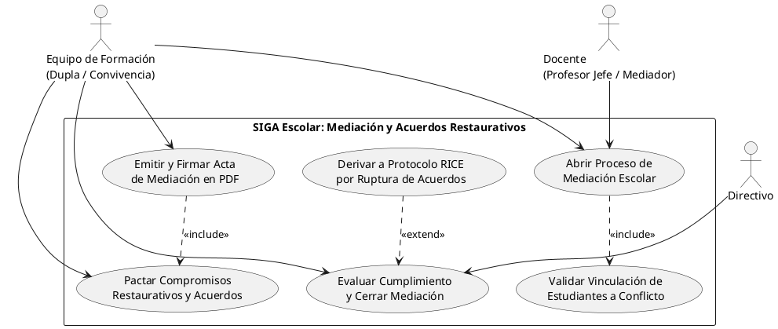
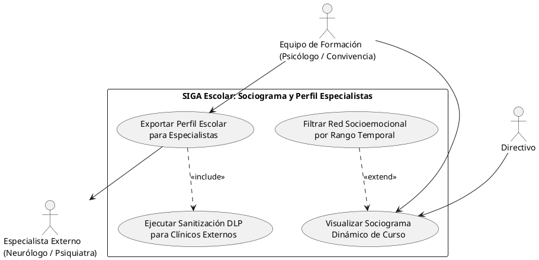
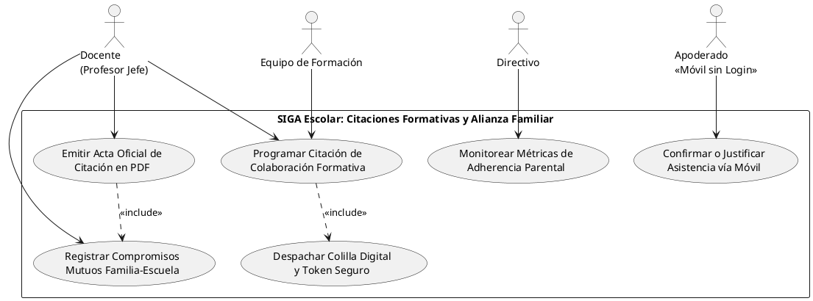

# ESPECIFICACIÓN FORMAL DE CASOS DE USO UML 2.5 — FASE EVOLUTIVA
## Módulos de Sprints 7.2, 8 y 10 (Mediación, Sociograma y Citaciones)
**Cliente Institucional:** Escuela Coeducacional N° 1 El Salvador, Atacama, Chile  
**Entidad Académica:** Universidad Tecnológica de Chile INACAP (Proyecto de Título)  
**Referencia Técnica:** *UML Distilled (Martin Fowler)*, Alistair Cockburn, IEEE 830, Ley N° 19.628  
**Versión:** 1.0 (PlantUML / Nomenclatura Limpia Fowler)  
**Fecha:** Octubre 2026  

---

## 1. INTRODUCCIÓN Y ALCANCE

Este documento complementa el catálogo maestro de casos de uso de SIGA Escolar, formalizando los **3 nuevos módulos de alto impacto pedagógico y normativo** programados en las épicas finales del proyecto:
1. **Épica 7.2 (Sprint 7):** Mediación Escolar y Acuerdos Restaurativos.
2. **Épica 8 (Sprint 8):** Sociograma Dinámico de Convivencia y Perfil Integral para Especialistas Externos.
3. **Épica 10 (Sprint 10):** Gestor de Citaciones Formativas y Alianza Familia-Escuela con Confirmación Móvil.

### Nuevos Actores Identificados:
* **`Apoderado (Acceso Móvil Tokenizado)`**: Actor primario externo que interactúa con el sistema sin requerir credenciales de login, mediante tokens criptográficos temporales de un solo uso (72 horas) para responder colillas de citación.
* **`Especialista Externo (Neurólogo / Psiquiatra / Psicólogo Clínico)`**: Actor secundario externo receptor del informe de perfil escolar estandarizado y sanitizado bajo la Ley N° 19.628.

---

## 2. PKG-08: MEDIACIÓN ESCOLAR Y ACUERDOS RESTAURATIVOS (SPRINT 7.2)

### 2.1 Diagrama de Casos de Uso (PlantUML)

### 2.2 Tabla de Especificación Técnica

| Código | Caso de Uso | Actores | Tipo / Relación | Épica / Requerimiento | Descripción Técnica |
| :--- | :--- | :--- | :--- | :---: | :--- |
| **CU-801** | Abrir Proceso de Mediación Escolar | Equipo Formación, Docente Mediador | Caso Base | Épica 7.2 (HU 7.2.1) | Genera expediente de mediación voluntaria con folio correlativo único `MED-2026-XXXX`. |
| **CU-802** | Validar Vinculación de Estudiantes a Conflicto | Sistema | `<<include>>` de CU-801 | Épica 7.2 | Comprueba que los estudiantes pertenezcan al mismo curso o tengan antecedentes en bitácora. |
| **CU-803** | Pactar Compromisos Restaurativos y Acuerdos | Equipo Formación | Caso Base | Épica 7.2 | Registro estructurado de compromisos formativos, tareas reparatorias y plazos de revisión. |
| **CU-804** | Emitir y Firmar Acta de Mediación en PDF | Equipo Formación | `<<include>>` de CU-803 | Épica 7.2 | Compila PDF oficial con PDFKit conteniendo acuerdos, fecha de seguimiento y firmas de partes. |
| **CU-805** | Evaluar Cumplimiento y Cerrar Mediación | Equipo Formación, Directivo | Caso Base | Épica 7.2 | Cierre formal tras sesión de seguimiento a 15/30 días marcando estado `RESUELTA`. |
| **CU-806** | Derivar a Protocolo RICE por Ruptura | Sistema / Equipo Formación | `<<extend>>` de CU-805 | Épica 7.2, RF-08 | *Punto de extensión:* Incumplimiento reiterado o agresión grave posterior. Dispara flujo RICE. |

---

## 3. PKG-09: DINÁMICAS SOCIOEMOCIONALES Y COLABORACIÓN EXTERNA (SPRINT 8)

### 3.1 Diagrama de Casos de Uso (PlantUML)

### 3.2 Tabla de Especificación Técnica

| Código | Caso de Uso | Actores | Tipo / Relación | Épica / Requerimiento | Descripción Técnica |
| :--- | :--- | :--- | :--- | :---: | :--- |
| **CU-901** | Visualizar Sociograma Dinámico de Curso | Equipo Formación, Directivo | Caso Base | Épica 8 (HU 8.1.1) | Renderiza grafo interactivo de nodos (alumnos) y aristas ponderadas por co-ocurrencias en incidentes. |
| **CU-902** | Filtrar Red Socioemocional por Rango Temporal | Equipo Formación | `<<extend>>` de CU-901 | Épica 8 | Permite filtrar la red por mes, semestre o año para ver la evolución de alianzas y tensiones. |
| **CU-903** | Exportar Perfil Escolar para Especialistas | Equipo Formación, Especialista Externo | Caso Base | Épica 8 (HU 8.2) | Genera informe clínico-conductual estandarizado para neurólogos y psicólogos tratantes. |
| **CU-904** | Ejecutar Sanitización DLP para Clínicos | Sistema | `<<include>>` de CU-903 | RNF-09, Ley 19.628 | Anonimiza nombres de terceros y compañeros involucrados, protegiendo la privacidad de menores. |

---

## 4. PKG-10: CITACIONES FORMATIVAS Y ALIANZA FAMILIA-ESCUELA (SPRINT 10)

### 4.1 Diagrama de Casos de Uso (PlantUML)

### 4.2 Tabla de Especificación Técnica

| Código | Caso de Uso | Actores | Tipo / Relación | Épica / Requerimiento | Descripción Técnica |
| :--- | :--- | :--- | :--- | :---: | :--- |
| **CU-1001** | Programar Citación Formativa | Docente, Equipo Formación | Caso Base | Épica 10 (HU 10.1) | Genera citación con folio `CIT-2026-XXXX`, motivo formativo positivo y fecha tentativa. |
| **CU-1002** | Despachar Colilla Digital y Token Seguro | Sistema | `<<include>>` de CU-1001 | Épica 10 | Genera token criptográfico temporal de 72h y despacha email con enlace responsive sin login. |
| **CU-1003** | Confirmar o Justificar Asistencia vía Móvil | Apoderado (Móvil) | Caso Base | Épica 10 (HU 10.1) | Interfaz pública móvil de 1-clic para confirmar asistencia o solicitar reprogramación de fecha. |
| **CU-1004** | Registrar Compromisos Mutuos Familia-Escuela | Docente | Caso Base | Épica 10 (HU 10.2) | Acta digital de la reunión con acuerdos bidireccionales (compromisos del colegio y del hogar). |
| **CU-1005** | Emitir Acta Oficial de Citación en PDF | Docente | `<<include>>` de CU-1004 | Épica 10 | Generación del documento formal con membrete del colegio y espacios de firma presencial. |
| **CU-1006** | Monitorear Métricas de Adherencia Parental | Directivo | Caso Base | Épica 10 (HU 10.3) | Dashboard analítico que mide la tasa de asistencia de apoderados por curso y ciclo escolar. |

---

## 5. GUÍA DE INTEGRACIÓN PARA EL MODELADOR EN DRAW.IO

Tu compañero puede abrir Draw.io y copiar/pegar directamente cualquiera de estos 3 bloques PlantUML (`+` $\rightarrow$ `Avanzado` $\rightarrow$ `PlantUML`):
1. **Separación visual clara:** Cada paquete representa un subsistema cohesivo de 4 a 6 casos de uso, ideal para diagramar en una página individual sin generar cruces de líneas complejos.
2. **Actor Apoderado Móvil:** Se modela a la izquierda en PKG-10 porque es el iniciador de la acción de confirmación sobre el caso de uso `CU-1003`.
3. **Actor Especialista Externo:** Se modela a la derecha en PKG-09 porque es el receptor del informe clínico generado.
