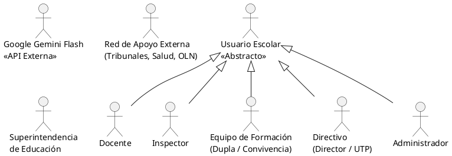
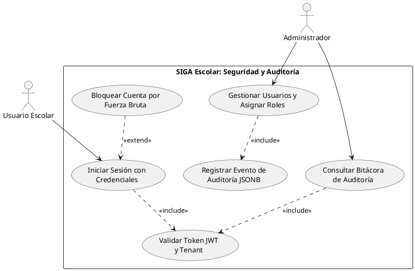
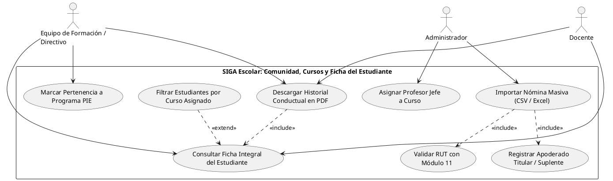
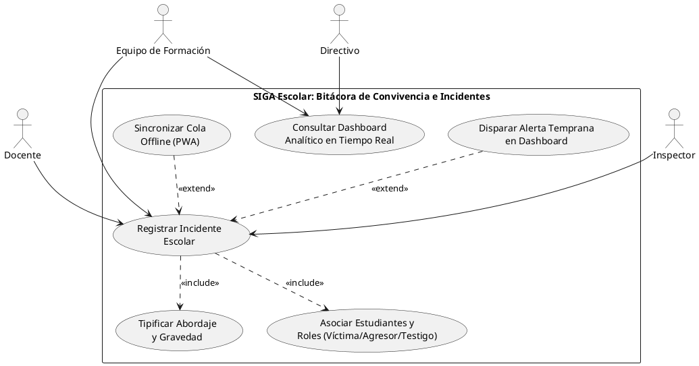
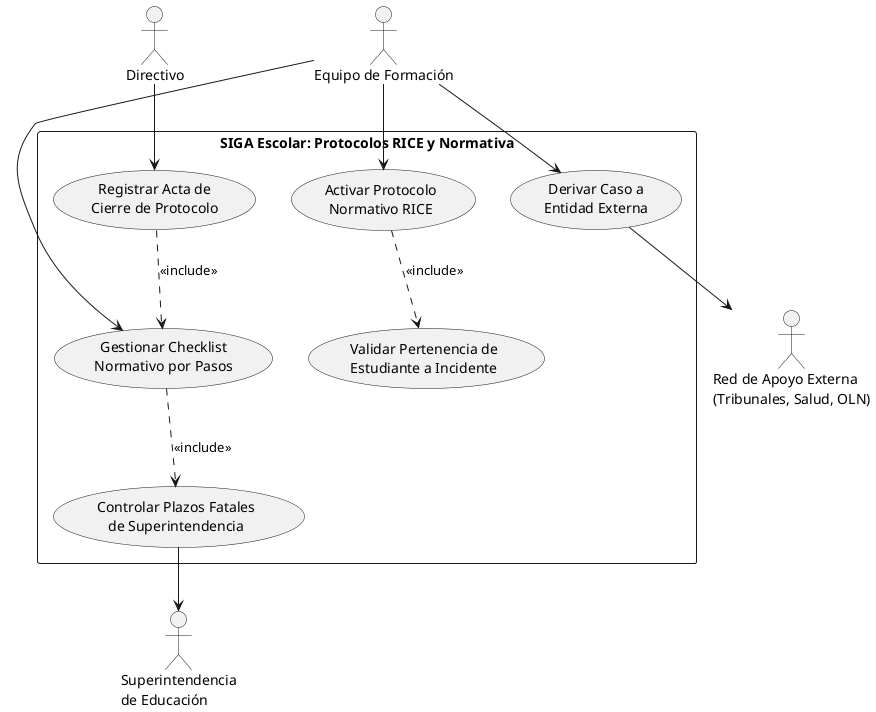
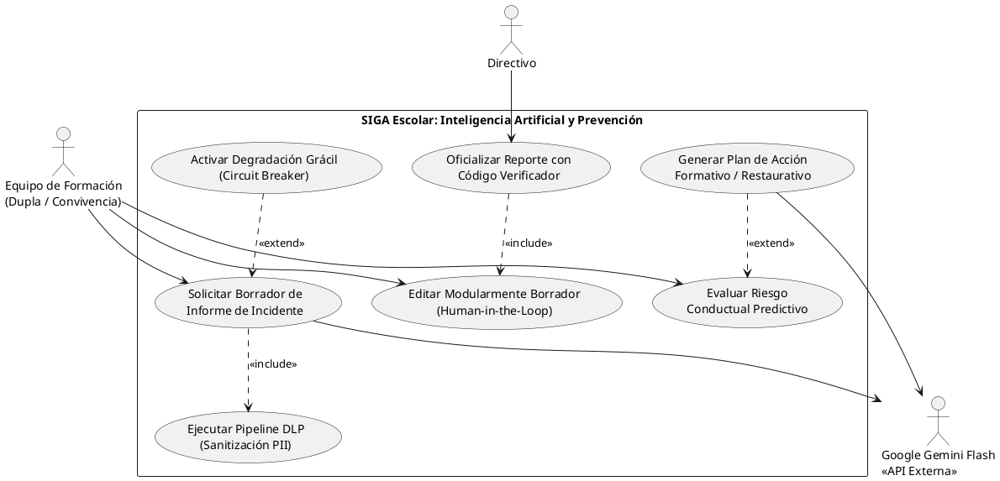
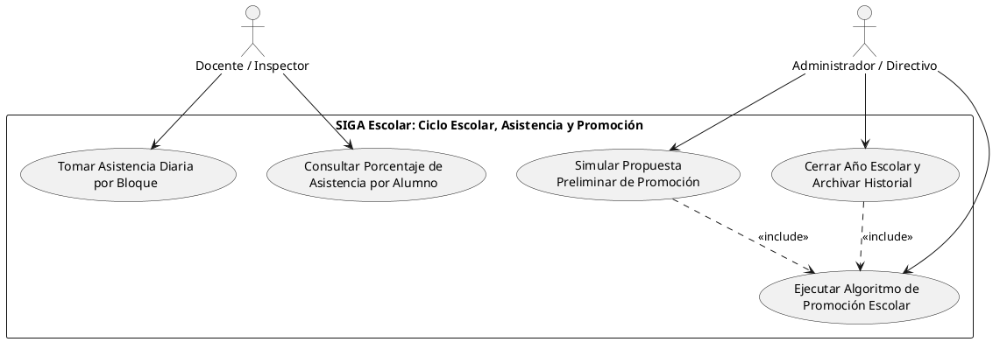
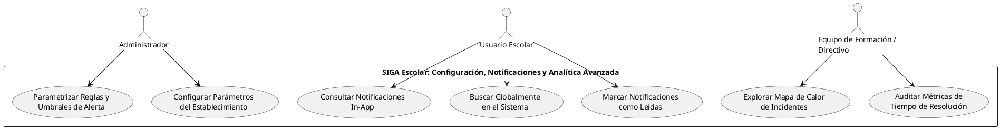

# ESPECIFICACIÓN FORMAL DE CASOS DE USO UML 2.5
## Sistema de Gestión y Acompañamiento Escolar (SIGA Escolar)
**Cliente Institucional:** Escuela Coeducacional N° 1 El Salvador, Atacama, Chile  
**Entidad Académica:** Universidad Tecnológica de Chile INACAP (Proyecto de Título)  
**Referencia Técnica:** *UML Distilled (3rd Edition / Martin Fowler)*, Alistair Cockburn (Writing Effective Use Cases), IEEE 830, Modelo 4+1 Vistas (Kruchten)  
**Versión:** 2.1 (Modelo Exhaustivo PlantUML / Estándar Fowler)  
**Fecha:** Octubre 2026  

---

## 1. INTRODUCCIÓN Y CONVENCIONES DE MODELADO

Este documento contiene la especificación técnica y formal de la **totalidad de los Casos de Uso del Sistema SIGA Escolar (Modelo Exhaustivo)**. Los diagramas están formulados en **PlantUML**, optimizados para su renderizado directo e importación vectorial en **Draw.io** (`+` $\rightarrow$ `Avanzado` $\rightarrow$ `PlantUML`) o cualquier herramienta CASE (Visual Paradigm, Enterprise Architect, Lucidchart).

### Convenciones UML 2.5 / Estándar Fowler:
* **Nombres de Casos de Uso en los Óvalos:** Siguiendo la regla de oro de Martin Fowler (*UML Distilled*), cada óvalo contiene únicamente una **frase verbal activa representativa de la meta del usuario** (ej. *"Registrar Incidente Escolar"*). Se eliminan prefijos o códigos alfanuméricos dentro de los óvalos para evitar saturación gráfica.
* **Alias Técnicos:** Cada caso de uso conserva un identificador interno inmutable (`as CU101`, `as CU301`) para conectar relaciones y preservar trazabilidad biunívoca con la matriz de requerimientos del proyecto de título.
* **Límite del Sistema (*System Boundary*):** Rectángulo que delimita el alcance funcional del software frente a actores humanos y sistemas externos.
* **Relación `<<include>>` (Inclusión obligatoria):** El caso de uso base requiere incondicionalmente la ejecución del caso de uso incluido: `Base ..> Incluido : <<include>>`.
* **Relación `<<extend>>` (Extensión condicional):** Modela comportamientos opcionales o excepcionales activados bajo un punto de extensión específico: `Extension ..> Base : <<extend>>`.
* **Generalización de Actores:** Herencia de capacidades y permisos desde un actor general abstracto hacia actores especializados (`<|--`).

---

## 2. TAXONOMÍA Y JERARQUÍA DE ACTORES

---

## 3. MAPA GENERAL DE PAQUETES DE CASOS DE USO

El sistema se estructura de forma modular en **7 paquetes cohesivos**:

* **PKG-01:** Seguridad, Autenticación y Auditoría (RBAC & Multi-tenant)
* **PKG-02:** Gestión de la Comunidad Educativa, Cursos y Estudiantes
* **PKG-03:** Bitácora de Convivencia y Registro de Incidentes (Mobile-First)
* **PKG-04:** Protocolos Normativos RICE y Redes de Derivación Externa
* **PKG-05:** Inteligencia Artificial Generativa y Analítica Predictiva
* **PKG-06:** Asistencia, Algoritmo de Promoción y Cierre de Ciclo Escolar
* **PKG-07:** Configuración Institucional, Notificaciones y Analítica Avanzada

---

## 4. PKG-01: SEGURIDAD, AUTENTICACIÓN Y AUDITORÍA

### 4.1 Diagrama de Casos de Uso (PlantUML)

### 4.2 Tabla de Especificación Técnica

| Código | Caso de Uso | Actores | Tipo / Relación | Requerimiento Trazable | Descripción Técnica |
| :--- | :--- | :--- | :--- | :---: | :--- |
| **CU-101** | Iniciar Sesión con Credenciales | Usuario Escolar | Caso Base | RF-01 | Autenticación con email/contraseña, verificación bcrypt y emisión de JWT (8h). |
| **CU-102** | Bloquear Cuenta por Fuerza Bruta | Sistema | `<<extend>>` de CU-101 | RF-01 | Se activa si se registran 5 intentos fallidos consecutivos. Bloquea cuenta por 15 min. |
| **CU-103** | Gestionar Usuarios y Asignar Roles | Administrador | Caso Base | RF-02, RF-04 | CRUD de cuentas con validación de RBAC y salvaguarda del último admin activo. |
| **CU-104** | Consultar Bitácora de Auditoría | Administrador | Caso Base | RF-03 | Visualización de eventos de auditoría con filtrado por fecha, actor y tabla. |
| **CU-105** | Validar Token JWT y Tenant | Sistema | `<<include>>` de CU-101/104 | RF-01, RNF-01 | Extracción criptográfica de `user_id`, `rol` y `tenant_id` en cada petición HTTP. |
| **CU-106** | Registrar Evento de Auditoría JSONB | Sistema | `<<include>>` de CU-103 | RF-03 | Registro asíncrono e inmutable (`setImmediate`) de eventos CRUD con IP y metadata. |

---

## 5. PKG-02: GESTIÓN DE LA COMUNIDAD EDUCATIVA, CURSOS Y ESTUDIANTES

### 5.1 Diagrama de Casos de Uso (PlantUML)

### 5.2 Tabla de Especificación Técnica

| Código | Caso de Uso | Actores | Tipo / Relación | Requerimiento Trazable | Descripción Técnica |
| :--- | :--- | :--- | :--- | :---: | :--- |
| **CU-201** | Importar Nómina Masiva (CSV/Excel) | Administrador | Caso Base | RF-05 | Ingesta masiva por lotes de estudiantes, cursos y apoderados sin detenerse por errores. |
| **CU-202** | Validar RUT con Módulo 11 | Sistema | `<<include>>` de CU-201 | RF-05 | Validación algorítmica del dígito verificador; reporta filas erróneas a log de fallos. |
| **CU-203** | Consultar Ficha Integral del Estudiante | Equipo Formación, Directivo, Docente | Caso Base | RF-05 | Vista 360° con datos biográficos, apoderados, cursos y línea de tiempo de incidentes. |
| **CU-204** | Marcar Pertenencia a Programa PIE | Equipo Formación | Caso Base | RF-05, RF-15 | Indicador de necesidades educativas especiales para contextualizar mediaciones. |
| **CU-205** | Descargar Historial Conductual en PDF | Equipo Formación, Docente, Directivo | Caso Base | RF-11 | Emisión de informe oficial con membrete del colegio, firmas y cronología de faltas. |
| **CU-206** | Registrar Apoderado Titular / Suplente | Sistema | `<<include>>` de CU-201 | RF-05 | Creación y vinculación del tutor legal y contactos de emergencia del alumno. |
| **CU-207** | Filtrar Estudiantes por Curso Asignado | Sistema | `<<extend>>` de CU-203 | RF-02 | Restringe la visualización del docente únicamente a sus cursos asignados. |
| **CU-208** | Asignar Profesor Jefe a Curso | Administrador | Caso Base | RF-02 | Configuración de jefaturas pedagógicas para control jerárquico de acceso. |

---

## 6. PKG-03: BITÁCORA DE CONVIVENCIA Y REGISTRO DE INCIDENTES

### 6.1 Diagrama de Casos de Uso (PlantUML)

### 6.2 Tabla de Especificación Técnica

| Código | Caso de Uso | Actores | Tipo / Relación | Requerimiento Trazable | Descripción Técnica |
| :--- | :--- | :--- | :--- | :---: | :--- |
| **CU-301** | Registrar Incidente Escolar | Docente, Inspector, Equipo Formación | Caso Base | RF-06 | Formulario móvil/desktop para registrar fecha, lugar, medidas tomadas y relato. |
| **CU-302** | Tipificar Abordaje y Gravedad | Sistema / Usuario | `<<include>>` de CU-301 | RF-06 | Clasificación según RICE: Indagación, Mediación, Conflicto y gravedad (Leve, Grave, Gravísimo). |
| **CU-303** | Asociar Estudiantes y Roles | Sistema / Usuario | `<<include>>` de CU-301 | RF-06 | Vincula a los involucrados clasificándolos como Víctima, Agresor o Testigo. |
| **CU-304** | Disparar Alerta Temprana en Dashboard | Sistema | `<<extend>>` de CU-301 | RF-07 | Se activa si gravedad es Grave o Gravísima, notificando a Coordinación y Dirección. |
| **CU-305** | Consultar Dashboard Analítico en Tiempo Real | Equipo Formación, Directivo | Caso Base | RF-10 | Panel con indicadores en tiempo real: distribución por abordaje, cursos críticos y gráficos. |
| **CU-306** | Sincronizar Cola Offline (PWA) | Sistema | `<<extend>>` de CU-301 | RNF-05 | Si falla la conexión en patio, almacena en IndexedDB y sincroniza al recuperar red. |

---

## 7. PKG-04: PROTOCOLOS NORMATIVOS RICE Y REDES DE DERIVACIÓN

### 7.1 Diagrama de Casos de Uso (PlantUML)

### 7.2 Tabla de Especificación Técnica

| Código | Caso de Uso | Actores | Tipo / Relación | Requerimiento Trazable | Descripción Técnica |
| :--- | :--- | :--- | :--- | :---: | :--- |
| **CU-401** | Activar Protocolo Normativo RICE | Equipo de Formación | Caso Base | RF-08 | Apertura formal de uno de los 10 protocolos normativos Superintendencia. |
| **CU-402** | Validar Pertenencia de Estudiante a Incidente | Sistema | `<<include>>` de CU-401 | RF-08 | Regla de integridad: el alumno debe haber sido parte del incidente origen. |
| **CU-403** | Gestionar Checklist Normativo por Pasos | Equipo de Formación | Caso Base | RF-09 | Flujo secuencial interactivo con registro de observaciones obligatorias por etapa. |
| **CU-404** | Controlar Plazos Fatales de Superintendencia | Sistema | `<<include>>` de CU-403 | RF-09 | Cálculo en días hábiles frente al vencimiento normativo para evitar sanciones. |
| **CU-405** | Derivar Caso a Entidad Externa | Equipo de Formación, Red Externa | Caso Base | RF-08 | Registro de derivación formal a Fiscalía, Tribunales, CESFAM, OLN o Mejor Niñez. |
| **CU-406** | Registrar Acta de Cierre de Protocolo | Directivo | Caso Base | RF-09 | Clausura del caso con informe de medidas restaurativas y compromisos familiares. |

---

## 8. PKG-05: INTELIGENCIA ARTIFICIAL GENERATIVA Y ANALÍTICA PREDICTIVA

### 8.1 Diagrama de Casos de Uso (PlantUML)

### 8.2 Tabla de Especificación Técnica

| Código | Caso de Uso | Actores | Tipo / Relación | Requerimiento Trazable | Descripción Técnica |
| :--- | :--- | :--- | :--- | :---: | :--- |
| **CU-501** | Solicitar Borrador de Informe de Incidente | Equipo de Formación, Gemini Flash | Caso Base | RF-12 | Petición a Gemini Flash para generar borrador estructurado en formato JSON. |
| **CU-502** | Ejecutar Pipeline DLP (Sanitización PII) | Sistema | `<<include>>` de CU-501 | RNF-09 | Enmascara nombres por roles sintácticos y elimina RUTs/domicilios (Ley 19.628). |
| **CU-503** | Editar Modularmente Borrador (Human-in-the-Loop) | Equipo de Formación | Caso Base | RF-13 | Interfaz interactiva para modificar secciones, regenerar o aprobar el texto. |
| **CU-504** | Oficializar Reporte con Código Verificador | Directivo | Caso Base | RF-14 | Emisión de PDF oficial inmutable con código criptográfico y bloques de firma. |
| **CU-505** | Evaluar Riesgo Conductual Predictivo | Equipo de Formación | Caso Base | RF-15 | Correlación de faltas, temporalidad y PIE para predecir focos de violencia. |
| **CU-506** | Generar Plan de Acción Formativo / Restaurativo | Gemini Flash | `<<extend>>` de CU-505 | RF-16 | Sugerencia automática de intervenciones psicosociales no punitivas ante alto riesgo. |
| **CU-507** | Activar Degradación Grácil (Circuit Breaker) | Sistema | `<<extend>>` de CU-501 | RNF-12 | Ante caída de API (HTTP 429/500), ofrece plantillas locales sin bloquear al usuario. |

---

## 9. PKG-06: ASISTENCIA, PROMOCIÓN Y CIERRE DE CICLO ESCOLAR

### 9.1 Diagrama de Casos de Uso (PlantUML)

### 9.2 Tabla de Especificación Técnica

| Código | Caso de Uso | Actores | Tipo / Relación | Requerimiento Trazable | Descripción Técnica |
| :--- | :--- | :--- | :--- | :---: | :--- |
| **CU-601** | Tomar Asistencia Diaria por Bloque | Docente, Inspector | Caso Base | Módulo Asistencia | Marcaje por estudiante (Presente, Ausente, Justificado, Atraso) en tiempo real. |
| **CU-602** | Consultar Porcentaje de Asistencia por Alumno | Docente | Caso Base | Módulo Asistencia | Cálculo acumulado para supervisar umbral mínimo de 85% exigido por MINEDUC. |
| **CU-603** | Simular Propuesta Preliminar de Promoción | Administrador, Directivo | Caso Base | Módulo Promoción | Vista previa no destructiva de promovidos/reprobados con alertas de casos borde. |
| **CU-604** | Ejecutar Algoritmo de Promoción Escolar | Sistema | `<<include>>` de CU-603/605 | Módulo Promoción | Valida notas, asistencia y criterios RICE para determinar si el alumno es promovido. |
| **CU-605** | Cerrar Año Escolar y Archivar Historial | Administrador | Caso Base | Módulo Promoción | Congela el periodo lectivo, promueve niveles y archiva antecedentes históricos. |

---

## 10. PKG-07: CONFIGURACIÓN INSTITUCIONAL, NOTIFICACIONES Y ANALÍTICA AVANZADA

### 10.1 Diagrama de Casos de Uso (PlantUML)

### 10.2 Tabla de Especificación Técnica

| Código | Caso de Uso | Actores | Tipo / Relación | Requerimiento Trazable | Descripción Técnica |
| :--- | :--- | :--- | :--- | :---: | :--- |
| **CU-701** | Configurar Parámetros del Establecimiento | Administrador | Caso Base | RF-02, RNF-10 | Gestión de RBD, datos de Rectoría, Coordinación, membrete y logotipo escolar. |
| **CU-702** | Parametrizar Reglas y Umbrales de Alerta | Administrador | Caso Base | RF-07, RNF-10 | Ajuste de tolerancias de inactividad, plazos fatales y ponderadores de riesgo. |
| **CU-703** | Consultar Notificaciones In-App | Usuario Escolar | Caso Base | RF-07 | Centro de avisos y campanita superior con contador reactivo de no leídas. |
| **CU-704** | Marcar Notificaciones como Leídas | Usuario Escolar | Caso Base | RF-07 | Actualización de estado de alertas y descartes individuales o masivos. |
| **CU-705** | Buscar Globalmente en el Sistema | Usuario Escolar | Caso Base | RNF-09 | Barra Omnibox en el header para localizar estudiantes por RUT, nombre o incidentes. |
| **CU-706** | Explorar Mapa de Calor de Incidentes | Equipo Formación, Directivo | Caso Base | RF-10 | Matriz analítica Curso vs. Mes escolar para detectar patrones temporales de conflicto. |
| **CU-707** | Auditar Métricas de Tiempo de Resolución | Equipo Formación, Directivo | Caso Base | RF-10 | Indicadores de cumplimiento de SLA y días promedio de tramitación de protocolos RICE. |

---

## 11. GUÍA PARA EL MODELADOR VISUAL (COMPAÑERO DE EQUIPO)

Para generar los diagramas visuales en **Draw.io / diagrams.net**:

1. Abrir **Draw.io**.
2. En la barra superior o menú izquierdo hacer clic en:  
   👉 **`+` (Insertar) $\rightarrow$ `Avanzado` $\rightarrow$ `PlantUML`**.
3. Copiar el bloque `@startuml ... @enduml` del paquete deseado y pegarlo en el cuadro de diálogo.
4. Presionar el botón **Insertar**.
5. **Resultado automático:** Draw.io creará los actores con su figura reglamentaria (*stick figure*), los casos de uso como óvalos vectoriales con texto centrado limpio (sin códigos que saturen la vista), y las relaciones `<<include>>` y `<<extend>>` con líneas punteadas y estereotipos oficiales.
