# ESPECIFICACIÓN FORMAL DEL DIAGRAMA DE ARQUITECTURA DE SOFTWARE
## Vista Lógica Multicapa (N-Tier Layered Architecture) — Sistema SIGA Escolar (Sprints 1 al 11)
**Cliente Institucional:** Escuela Coeducacional N° 1 El Salvador, Atacama, Chile  
**Entidad Académica:** Universidad Tecnológica de Chile INACAP (Proyecto de Título)  
**Capítulo del Informe:** Capítulo VII — Definición de Arquitectura TI (Modelo Kruchten 4+1: Vista Lógica)  
**Referencia Técnica:** *Software Architecture in Practice (Bass, Clements & Kazman)*, IEEE 1471 / ISO/IEC 42010, Estándar IEEE 830  
**Versión:** 1.0 (Arquitectura Lógica de 5 Capas / Diseño Planar Anti-Cruces para Draw.io)  
**Fecha:** Octubre 2026  

---

## 1. RESUMEN EJECUTIVO Y FUNDAMENTACIÓN ARQUITECTÓNICA

El **Diagrama de Arquitectura de Software** define la estructura lógica interna, la organización modular y las fronteras de responsabilidad del sistema **SIGA Escolar**. A diferencia del *Diagrama de Componentes* (vista de desarrollo con interfaces y contratos internos) y del *Diagrama de Infraestructura* (vista física de despliegue en la nube), este diagrama representa la **Vista Lógica (Kruchten 4+1)** del sistema, sirviendo como núcleo central para el **Capítulo VII: Definición de Arquitectura TI** de la memoria de título.

### Principios de Diseño Arquitectónico Aplicados:
1. **Separación de Responsabilidades (*Separation of Concerns - SoC*):** Cada capa resuelve un problema técnico específico (presentación, control perimetral, reglas de dominio, inteligencia artificial y persistencia), impidiendo el acoplamiento cruzado.
2. **Dependencia Unidireccional Descendente (*Strict Layering*):** Las capas superiores consumen servicios de las capas inferiores inmediatas, garantizando que el núcleo de negocio sea independiente de los detalles de la interfaz de usuario o del almacenamiento físico.
3. **Privacidad por Diseño (*Privacy by Design* — Ley N° 19.628 y N° 21.719):** Los flujos de inteligencia artificial y persistencia cuentan con capas intermedias de anonimización estricta (DLP) y aislamiento forzoso de datos (*Row Level Security*).
4. **Resiliencia y Modo Degradado (*Graceful Degradation*):** Integración de mecanismos de contingencia offline (PWA en patio escolar) y conmutación por fallos (*Circuit Breaker* en el consumo del LLM).

---

## 2. DIAGRAMA DE ARQUITECTURA DE SOFTWARE (PLANTUML v1.0)

```plantuml
@startuml
skinparam componentStyle uml2
skinparam packageStyle rectangle
skinparam shadowing false
skinparam monochrome true
skinparam linetype ortho
skinparam nodesep 25
skinparam ranksep 35

top to bottom direction

' ==========================================================
' CAPA 1: PRESENTACIÓN Y EXPERIENCIA DE USUARIO (CLIENT-SIDE)
' ==========================================================
package "Capa 1: Presentación y Experiencia de Usuario (Frontend SPA / PWA)" as Layer1 {
  [Módulo de Navegación y UI Core\n(React 18 / Tailwind CSS / Lucide Icons)] as UINav
  [Gestión de Estado Reactivo\n(Zustand: auth, offline, notif)] as UIState
  [Motor de Contingencia Offline\n(Service Worker & IndexedDB)] as UIOffline
  [Portal Móvil de Apoderados\n(Web Móvil Token 72h / 1-Clic)] as UIParentPortal

  UINav -[hidden]right- UIState
  UIState -[hidden]right- UIOffline
  UIOffline -[hidden]right- UIParentPortal

  UINav ..> UIState : actualiza estado
  UINav ..> UIOffline : fallback en patio escolar
}

' ==========================================================
' CAPA 2: SEGURIDAD PERIMETRAL, CONTROL Y TRANSPORTE
' ==========================================================
package "Capa 2: Control, Seguridad Perimetral y Transporte (API Gateway)" as Layer2 {
  [Filtros de Seguridad Perimetral\n(Helmet / CORS Estricto / RateLimiter)] as SecFilter
  [Middleware de Autenticación y RBAC\n(JWT Verify & requireRole)] as AuthMiddleware
  [Auditoría Forense Inmutable\n(auditLogger / setImmediate)] as AuditMiddleware
  [Enrutador y Validación Sintáctica\n(Express 5 Router / Zod Schemas)] as RouterMiddleware
  [Servidor de Canales en Vivo\n(Socket.io / Rooms por tenant_id)] as WsServer

  SecFilter -[hidden]right- AuthMiddleware
  AuthMiddleware -[hidden]right- RouterMiddleware
  RouterMiddleware -[hidden]right- AuditMiddleware
  AuditMiddleware -[hidden]right- WsServer

  SecFilter ..> AuthMiddleware : previene abusos
  AuthMiddleware ..> RouterMiddleware : inyecta tenant_id y rol
  RouterMiddleware ..> AuditMiddleware : deriva traza de auditoría
}

' Conexiones Capa 1 -> Capa 2
UIState ..> SecFilter : "HTTPS / TLS 1.3 (REST API)\nAuthorization: Bearer <JWT>"
UIParentPortal ..> SecFilter : "HTTPS / TLS 1.3 (Acceso Público)\nToken Criptográfico 72h"
UIState ..> WsServer : "WSS / TLS 1.3 (WebSockets)\nCanal Alertas en Tiempo Real"

' ==========================================================
' CAPA 3: LÓGICA DE NEGOCIO Y SERVICIOS DE DOMINIO
' ==========================================================
package "Capa 3: Lógica de Negocio y Servicios de Dominio (Core Institucional)" as Layer3 {

  package "Sub-Dominio Convivencia Escolar" as SubConvivencia {
    [Gestor de Incidentes Tipificados\n(incidentesService)] as IncSvc
    [Orquestador Protocolos RICE\n(protocolosService & derivaciones)] as RiceSvc
  }

  package "Sub-Dominio Gestión Escolar" as SubEscolar {
    [Administrador Estudiantes y Matrícula\n(estudiantesService - Módulo 11)] as EstSvc
    [Asistente Cierre de Año y Promoción\n(cierreAnioService - Secuencia Niveles)] as CierreSvc
  }

  package "Sub-Dominio Familias y Redes" as SubFamilias {
    [Servicio de Mediación Escolar\n(mediacionesService - Folio MED)] as MedSvc
    [Servicio de Citaciones Formativas\n(citacionesService - Folio CIT)] as CitSvc
    [Motor de Sociograma Dinámico\n(sociogramaService - Co-ocurrencias)] as SocioSvc
  }

  [Compilador Documental Vectorial\n(pdfService / PDFKit)] as PdfSvc

  SubConvivencia -[hidden]right- SubEscolar
  SubEscolar -[hidden]right- SubFamilias
  SubFamilias -[hidden]right- PdfSvc

  IncSvc ..> RiceSvc : activa protocolo formal
  IncSvc ..> PdfSvc : compila acta oficial
  MedSvc ..> PdfSvc : compila acuerdos mutuos
  CierreSvc ..> PdfSvc : compila acta anual promoción
}

' Conexiones Capa 2 -> Capa 3
RouterMiddleware ..> IncSvc : despacho convivencia
RouterMiddleware ..> EstSvc : despacho escolar
RouterMiddleware ..> CitSvc : despacho familias
RouterMiddleware ..> MedSvc : despacho mediaciones

' ==========================================================
' CAPA 4: SERVICIOS TRANSVERSALES, INTELIGENCIA ARTIFICIAL Y ASÍNCRONO
' ==========================================================
package "Capa 4: Servicios Transversales, IA y Procesamiento Asíncrono" as Layer4 {
  [Pipeline de Sanitización DLP\n(dlpSanitizer - Ley N° 19.628)] as DlpSvc
  [Cliente IA con Circuit Breaker\n(geminiService / @google/genai)] as AiSvc
  [Caché L2 de Alta Velocidad\n(Redis Store / TTL Dinámico)] as CacheSvc
  [Gestor de Colas Asíncronas\n(Bull Queues: emailQueue / ausentismoJob)] as QueueSvc

  DlpSvc -[hidden]right- AiSvc
  AiSvc -[hidden]right- CacheSvc
  CacheSvc -[hidden]right- QueueSvc

  DlpSvc ..> AiSvc : envía payload anonimizado
  CitSvc ..> QueueSvc : encola despacho colillas
  IncSvc ..> DlpSvc : somete borrador a anonimización
  EstSvc ..> CacheSvc : consulta/invalida listados
}

' ==========================================================
' CAPA 5: PERSISTENCIA, ALMACENAMIENTO Y SERVICIOS EXTERNOS EN LA NUBE
' ==========================================================
package "Capa 5: Persistencia, Almacenamiento y Servicios Externos" as Layer5 {
  database "Supabase PostgreSQL 15\n(Row Level Security / tenant_id)" as PostgresDB
  database "Supabase Storage Buckets\n(Evidencias y Actas PDF)" as StorageDB
  database "Bitácora de Auditoría Forense\n(audit_log JSONB inmutable)" as AuditDB

  cloud "Google Cloud AI Studio\n(Gemini Flash 2.0 API)" as GoogleAICloud
  cloud "Servidor SMTP Institucional\n(STARTTLS / Despacho Emails)" as SmtpCloud
  cloud "Sentry Cloud Monitoring\n(Telemetría y Observabilidad)" as SentryCloud

  PostgresDB -[hidden]right- StorageDB
  StorageDB -[hidden]right- AuditDB
  AuditDB -[hidden]right- GoogleAICloud
  GoogleAICloud -[hidden]right- SmtpCloud
  SmtpCloud -[hidden]right- SentryCloud
}

' Conexiones Capa 3 y 4 -> Capa 5
SubConvivencia ..> PostgresDB : operaciones CRUD seguras
SubEscolar ..> PostgresDB : operaciones CRUD seguras
SubFamilias ..> PostgresDB : operaciones CRUD seguras
PdfSvc ..> StorageDB : almacena PDFs oficiales
AuditMiddleware ..> AuditDB : persistencia fire-and-forget
AiSvc ..> GoogleAICloud : HTTPS / TLS 1.3 (Inferencia)
QueueSvc ..> SmtpCloud : SMTP / STARTTLS 587
Layer2 ..> SentryCloud : HTTPS / TLS 1.3 (Errores)

@enduml
```

---

## 3. DICCIONARIO TÉCNICO DE LA ARQUITECTURA EN CAPAS

A continuación se detalla la responsabilidad de cada capa lógica, sus módulos representativos, tecnologías utilizadas y los patrones de diseño implementados:

| Capa Lógica | Componentes Principales | Tecnologías / Librerías | Responsabilidades Técnicas y Funcionales | Patrones de Diseño |
| :--- | :--- | :--- | :--- | :--- |
| **Capa 1: Presentación y Experiencia de Usuario** | `Vistas y Rutas Protegidas` `Gestor de Estado Global` `Motor PWA Offline` `Portal Móvil de Familias` | React 18, Vite, React Router 6, Zustand, Tailwind CSS, Workbox, IndexedDB | Renderizado reactivo de interfaces visuales, captura de eventos de usuario, enrutamiento condicional por rol (`ProtectedRoute`), gestión de estado en memoria y soporte de contingencia offline en patios sin señal. | *Single Page Application (SPA)*, *State Management Store*, *Optimistic UI*, *Service Worker Cache-First*. |
| **Capa 2: Seguridad Perimetral, Control y Transporte** | `Filtros Helmet / CORS` `RateLimiter` `Middleware JWT / RBAC` `Enrutadores Express` `Servidor Socket.io` | Express 5, jsonwebtoken, helmet, express-rate-limit, zod, socket.io | Punto único de entrada HTTP/WSS. Terminación perimetral, prevención de fuerza bruta, validación estricta de esquemas sintácticos (Zod), verificación criptográfica de identidad, inyección del contexto multi-tenant (`tenant_id`) y distribución de eventos push. | *API Gateway*, *Interceptor / Pipeline Pattern (Middleware Chain)*, *Role-Based Access Control (RBAC)*, *Publish/Subscribe (Rooms)*. |
| **Capa 3: Lógica de Negocio y Servicios de Dominio** | `incidentesService` `protocolosService` `estudiantesService` `cierreAnioService` `mediacionesService` `citacionesService` `sociogramaService` `pdfService` | Node.js Vanilla JS, PDFKit, date-fns | Orquestación pura de las reglas institucionales: tipificación de faltas (Leves, Graves, Gravísimas), máquina de estados de los 10 protocolos RICE con plazos fatales, validación algorítmica de RUT (Módulo 11), progresión de cursos en cierre de año, cálculo de adyacencia social y compilación vectorial de actas oficiales. | *Domain Model*, *Finite State Machine (FSM)*, *Strategy Pattern* (progresión escolar), *Template Method* (compilación documental). |
| **Capa 4: Servicios Transversales, IA y Asíncrono** | `dlpSanitizer` `geminiService` `Redis L2 Cache` `Bull Queue Workers` `node-cron Schedulers` | `@google/genai`, ioredis, bull, node-cron, crypto | Anonimización irreversible de PII (nombres, RUTs, domicilios) bajo la **Ley N° 19.628**, consumo resiliente del modelo fundacional Gemini Flash, aceleración de consultas repetitivas de analítica en memoria y gestión desacoplada de colas de envío de correos y tareas programadas. | *Data Loss Prevention (DLP)*, *Circuit Breaker*, *Cache-Aside*, *Asynchronous Worker Queue*, *Scheduled Task Pattern*. |
| **Capa 5: Persistencia, Almacenamiento y Nube Externa** | `PostgreSQL 15 (Supabase)` `audit_log (JSONB)` `Supabase Storage` `Google AI Studio` `Servidor SMTP` `Sentry Monitoring` | PostgreSQL 15 con RLS, Supabase Storage API, REST Cloud APIs, SMTP Client | Persistencia relacional transaccional protegida a nivel de base de datos con políticas de **Row Level Security (RLS)**, resguardo seguro de archivos binarios (evidencias fotográficas y PDFs), registro indeleble de auditoría forense y delegación a proveedores SaaS de IA, correo y observabilidad. | *Multi-Tenant Data Isolation (RLS)*, *Immutable Audit Log*, *Blob Storage Repository*, *Cloud Gateway Adapter*. |

---

## 4. MATRIZ DE ATRIBUTOS DE CALIDAD DE SOFTWARE (QAS)

La arquitectura lógica de **SIGA Escolar** fue concebida para satisfacer los atributos de calidad exigidos por la comisión evaluadora de INACAP y la normativa ministerial:

### 1. Seguridad de la Información y Privacidad (Prioridad Crítica)
* **Aislamiento Multi-Tenant (RLS):** Toda consulta a la base de datos es evaluada por la política PostgreSQL `WHERE tenant_id = current_setting('app.tenant_id')`, impidiendo cualquier fuga de información entre establecimientos educacionales distintos.
* **Cumplimiento Legal (Ley N° 19.628 y Ley N° 21.719):** El *DLP Sanitizer* de la Capa 4 garantiza que ningún dato identificable de un menor de edad sea enviado al modelo fundacional Google Gemini en la nube pública.
* **Control de Acceso (RBAC):** Jerarquía estricta de 5 roles (Administrador, Directivo, Coordinador, Inspector, Docente) validada tanto en el Gateway (Capa 2) como en los servicios de negocio (Capa 3).

### 2. Disponibilidad y Resiliencia
* **Contingencia Offline de Patio:** Los inspectores de patio pueden registrar incidentes sin conexión a Internet; el Service Worker y IndexedDB de la Capa 1 retienen las transacciones y las sincronizan automáticamente al retomar señal Wi-Fi.
* **Degradación Grácil (*Circuit Breaker*):** Si la cuota de la API de Google Gemini se agota o la red externa falla, el sistema conmuta automáticamente a plantillas pedagógicas predefinidas locales sin bloquear el flujo del usuario.

### 3. Rendimiento y Eficiencia
* **Caché en Memoria L2:** Las estadísticas del dashboard y listas masivas se almacenan en Redis con TTL inteligente, reduciendo los tiempos de respuesta de 800ms a menos de 50ms.
* **Desacoplamiento Asíncrono:** El envío de colillas de citación a correos de apoderados se delega a Bull Queues, permitiendo que la API REST responda de forma inmediata (<100ms) sin esperar la respuesta del servidor SMTP.

### 4. Mantenibilidad y Trazabilidad
* **Auditoría Forense Inmutable:** Cada operación de creación, edición o borrado registra un evento indeleble en `audit_log` con usuario, IP, marca temporal y payload anterior/nuevo en formato JSONB para fiscalizaciones de la Superintendencia de Educación.

---

## 5. GUÍA PASO A PASO PARA EL MODELADOR EN DRAW.IO

1. **Preparar el Lienzo:**
   - En Draw.io, abrir un nuevo documento o pestaña en blanco.
   - Si existen elementos previos, presionar **`Ctrl + A`** y luego **`Supr` / `Delete`** para asegurar que el lienzo esté completamente limpio.
2. **Insertar el Código PlantUML:**
   - Ir al menú: **`+` (Insertar) $\rightarrow$ `Avanzado` $\rightarrow$ `PlantUML...`**.
   - Pegar el código de la **Sección 2** de este documento y hacer clic en **Insertar**.
3. **Comprobación Visual:**
   - Observará una estructura modular en **5 niveles horizontales perfectamente apilados** de arriba hacia abajo.
   - Las conexiones entre capas descienden de manera vertical limpia sin cruzarse ni enredarse.
4. **Exportación:**
   - Guardar el archivo nativo como `diagrama de arquitectura de software SIGA ESCOLAR.drawio`.
   - Exportar la imagen en formato **PNG de alta resolución** (`Archivo -> Exportar como -> PNG...`, escala 100% o 150%, fondo blanco).
