# ESPECIFICACIÓN FORMAL DEL DIAGRAMA DE COMPONENTES UML 2.5
## Sistema de Gestión y Acompañamiento Escolar (SIGA Escolar)
**Cliente Institucional:** Escuela Coeducacional N° 1 El Salvador, Atacama, Chile  
**Entidad Académica:** Universidad Tecnológica de Chile INACAP (Proyecto de Título)  
**Referencia Técnica:** *UML Distilled (3rd Edition / Martin Fowler)*, Modelo 4+1 Vistas de Kruchten (Vista de Desarrollo), IEEE 1471 / ISO/IEC 42010  
**Versión:** 2.0 (Modelo Exhaustivo / PlantUML / Alta Fidelidad Técnica)  
**Fecha:** Octubre 2026  

---

## 1. INTRODUCCIÓN Y CONVENCIONES DE MODELADO

El **Diagrama de Componentes UML 2.5** corresponde a la **Vista de Desarrollo (*Development View*)** dentro del modelo arquitectónico 4+1 de Philippe Kruchten. Modela la estructura modular del software, sus límites, interfaces proporcionadas (*provided interfaces* / piruleta `()`), interfaces requeridas (*required interfaces* / zócalo `)(`) y las dependencias de ejecución entre subsistemas.

Esta versión exhaustiva refleja la totalidad del stack tecnológico del proyecto, incorporando los canales reactivos en tiempo real (**WebSockets**), el motor de búsqueda transversal (**Omnibox**), los servicios de **Configuración Institucional y Cursos**, y el subsistema de **Procesamiento Asíncrono en Segundo Plano (Jobs & Queues)**.

### Subsistemas representados:
1. **Capa de Presentación (Frontend SPA / PWA - React 18 / Vite)**
2. **Capa de Control y Transporte (Express 5 REST API & Servidor WebSocket)**
3. **Capa de Servicios de Dominio y Lógica de Negocio (Domain Services)**
4. **Subsistema de Procesamiento Asíncrono y Colas (Jobs & Queues)**
5. **Subsistema de Inteligencia Artificial y Privacidad (DLP + Gemini Flash)**
6. **Capa de Persistencia y Datos (PostgreSQL 15 / Supabase con RLS)**
7. **Servicios Externos en la Nube (Google AI Studio, SMTP)**

---

## 2. DIAGRAMA DE COMPONENTES GLOBAL (PLANTUML)

```plantuml
@startuml
skinparam componentStyle uml2
skinparam packageStyle rectangle
skinparam shadowing false
skinparam monochrome true

' ==========================================================
' CAPA DE PRESENTACIÓN (FRONTEND CLIENT - SPA / PWA)
' ==========================================================
package "Capa de Presentación (Frontend SPA / PWA - React 18)" as FrontendPkg {
  [Vistas y Enrutador\n(React Router DOM)] as RouterUI
  [Gestor de Estado Global\n(Zustand: auth, offline, notif)] as StateStore
  [Cliente HTTP Interceptor\n(Axios / Bearer JWT)] as HttpClient
  [Cliente WebSockets\n(socketService)] as WsClient
  [Motor Offline y Caché\n(Service Worker & IndexedDB)] as PWAEngine
  
  RouterUI ..> StateStore : consume estado
  StateStore ..> HttpClient : despacha peticiones REST
  StateStore <.. WsClient : actualiza notificaciones en vivo
  RouterUI ..> PWAEngine : fallback de red en patio
}

' ==========================================================
' CAPA DE ENTRADA, SEGURIDAD Y CONTROL (BACKEND API GATEWAY)
' ==========================================================
package "Capa de Control y Transporte (Express 5 & Sockets)" as GatewayPkg {
  interface "HTTP / REST API (TLS 1.3)" as HttpInterface
  interface "WSS / WebSockets (Real-Time)" as WsInterface
  
  [Filtros de Seguridad HTTP\n(Helmet / CORS / RateLimiter)] as SecFilter
  [Middleware de Autenticación y RBAC\n(JWT Verify & requireRole)] as AuthRBAC
  [Middleware de Auditoría Inmutable\n(AuditLogger / setImmediate)] as AuditMW
  [Controladores de Dominio y Omnibox\n(Express Route Handlers)] as Controllers
  [Servidor de WebSockets y Canales\n(Socket.io / sockets/index.js)] as WsServer
  
  HttpInterface - [SecFilter]
  SecFilter ..> [AuthRBAC]
  AuthRBAC ..> [Controllers] : request autorizado
  Controllers ..> [AuditMW] : fire-and-forget
  
  WsInterface - [WsServer]
  AuthRBAC ..> [WsServer] : autentica handshake WSS
}

HttpClient ..> HttpInterface : llamadas JSON
WsClient ..> WsInterface : canal bidireccional

' ==========================================================
' CAPA DE SERVICIOS DE DOMINIO Y REGLAS DE NEGOCIO
' ==========================================================
package "Capa de Dominio y Lógica de Negocio" as DomainPkg {
  [Servicio de Convivencia e Incidentes\n(incidentesService)] as IncidentesSvc
  [Servicio de Protocolos RICE\n(protocolosService & derivacionesService)] as ProtocolosSvc
  [Servicio de Comunidad y Alumnos\n(estudiantesService - Módulo 11)] as EstudiantesSvc
  [Servicio de Configuración y Cursos\n(configuracionService & cursosService)] as ConfigCursosSvc
  [Servicio de Ciclo y Promoción\n(cierreAnioService & asistenciaService)] as CierreSvc
  [Servicio de Analítica y Mapas de Calor\n(analyticsService & riesgoService)] as AnalyticsSvc
  [Motor de Búsqueda Transversal Omnibox\n(searchService)] as SearchSvc
  [Generador de Documentos Oficiales\n(pdfService / PDFKit)] as PdfSvc
  [Servicio de Notificaciones y Broadcasts\n(notificacionesService & broadcastsService)] as NotifSvc
  
  Controllers ..> IncidentesSvc
  Controllers ..> ProtocolosSvc
  Controllers ..> EstudiantesSvc
  Controllers ..> ConfigCursosSvc
  Controllers ..> CierreSvc
  Controllers ..> AnalyticsSvc
  Controllers ..> SearchSvc
  Controllers ..> NotifSvc
  
  NotifSvc ..> WsServer : emite evento push
  IncidentesSvc ..> NotifSvc : alerta grave / gravísima
  IncidentesSvc ..> PdfSvc : compila acta
  ProtocolosSvc ..> PdfSvc : compila oficio derivación
  CierreSvc ..> PdfSvc : compila informe promoción
}

' ==========================================================
' SUBSISTEMA DE TRABAJOS EN SEGUNDO PLANO Y COLAS (JOBS)
' ==========================================================
package "Procesamiento Asíncrono en Segundo Plano" as AsyncPkg {
  [Gestor de Colas y Tareas Programadas\n(Jobs: Ausentismo, Mensajes, EmailQueue)] as JobQueueSvc
  
  DomainPkg ..> JobQueueSvc : encola tarea
}

' ==========================================================
' SUBSISTEMA DE INTELIGENCIA ARTIFICIAL Y PRIVACIDAD
' ==========================================================
package "Subsistema de IA y Privacidad (Sprint 6 & 7)" as AIPkg {
  [Pipeline de Sanitización DLP\n(dlpSanitizer - Ley 19.628)] as DlpSvc
  [Cliente Gemini Flash & Circuit Breaker\n(geminiService / @google/genai)] as GeminiClient
  
  IncidentesSvc ..> DlpSvc : anonimiza PII
  AnalyticsSvc ..> DlpSvc : anonimiza historial
  DlpSvc ..> GeminiClient : payload ofuscado
}

' ==========================================================
' CAPA DE PERSISTENCIA Y ALMACENAMIENTO (SUPABASE)
' ==========================================================
package "Capa de Persistencia y Datos (PostgreSQL 15)" as PersistencePkg {
  interface "Supabase JS Client" as DbInterface
  [Motor Relacional PostgreSQL\n(Row Level Security / tenant_id)] as PostgresDB
  [Almacén de Objetos\n(Supabase Storage Buckets)] as ObjectStorage
  [Tabla de Auditoría Inmutable\n(audit_log JSONB)] as AuditTable
  
  DbInterface - [PostgresDB]
}

DomainPkg ..> DbInterface : operaciones CRUD
AuditMW ..> AuditTable : inserta log asíncrono
PdfSvc ..> ObjectStorage : almacena PDF oficial
IncidentesSvc ..> ObjectStorage : sube evidencias adjuntas

' ==========================================================
' SERVICIOS EXTERNOS (THIRD-PARTY APIS)
' ==========================================================
package "Servicios Externos en la Nube" as CloudPkg {
  [Google Gemini API\n(generativelanguage.googleapis.com)] as GeminiAPI
  [Servidor de Correo SMTP\n(Notificaciones y Alertas Críticas)] as SmtpServer
}

GeminiClient ..> GeminiAPI : HTTPS / Generative AI
JobQueueSvc ..> SmtpServer : despacho asíncrono de emails
@enduml
```

---

## 3. CATÁLOGO DETALLADO DE COMPONENTES POR SUBSISTEMA

### 3.1 Subsistema Frontend (Cliente Web SPA / PWA - React 18)
* **`Vistas y Enrutador (React Router DOM)`**: Gestiona la navegación declarativa y la protección de rutas basada en el rol del usuario autenticado (`<ProtectedRoute />`).
* **`Gestor de Estado Global (Zustand Stores)`**: Centraliza de forma reactiva el estado de autenticación (`authStore`), la cola de incidentes en espera de conexión (`offlineStore`) y el contador en vivo de alertas (`notificacionesStore`).
* **`Cliente HTTP Interceptor (Axios)`**: Inyecta automáticamente la cabecera `Authorization: Bearer <token>` en cada request saliente y gestiona la captura centralizada de errores HTTP 401 (desconexión) y 403 (acceso denegado).
* **`Cliente WebSockets (socketService)`**: Mantiene la conexión bidireccional permanente con el backend para recibir avisos instantáneos de incidentes críticos sin necesidad de recargar la página (*polling*).
* **`Motor Offline y Caché (Service Worker & IndexedDB)`**: Permite a inspectores reportar incidentes en zonas sin cobertura de patio mediante almacenamiento en IndexedDB y sincronización diferida automática al recuperar red.

### 3.2 Subsistema de Entrada y Control (API Gateway - Express 5 & Sockets)
* **`Filtros de Seguridad HTTP`**: 
  - `Helmet`: Establece cabeceras de seguridad estrictas (HSTS, CSP, X-Frame-Options).
  - `CORS`: Restringe el acceso únicamente a los dominios autorizados de la escuela.
  - `RateLimiter`: Previene ataques de fuerza bruta limitando peticiones por IP.
* **`Middleware de Autenticación y RBAC`**: Desencripta el token JWT firmado, extrae `user_id`, `rol` y `tenant_id`, y bloquea el acceso si el rol del usuario no cuenta con los privilegios requeridos. Autentica además el *handshake* inicial de WebSockets.
* **`Middleware de Auditoría Inmutable`**: Captura las operaciones de escritura (POST, PUT, PATCH, DELETE) y las deriva en segundo plano mediante `setImmediate()` a la bitácora de auditoría sin penalizar la latencia de respuesta al usuario.
* **`Servidor de WebSockets (Socket.io / sockets/index.js)`**: Orquesta salas por establecimiento (*rooms* por `tenant_id`) para distribuir avisos push selectivos según roles.

### 3.3 Subsistema de Servicios de Dominio
* **`incidentesService`**: Tipificación de faltas (Leves, Graves, Gravísimas), asignación de roles a involucrados (Víctima, Agresor, Testigo) y cálculo de reincidencia inmediata.
* **`protocolosService & derivacionesService`**: Máquina de estados para los 10 protocolos normativos RICE, control de checklists secuenciales y cómputo de plazos fatales en días hábiles de la Superintendencia de Educación.
* **`estudiantesService`**: Módulo de ingesta masiva streaming (CSV/Excel) con validación estricta de RUT chileno mediante algoritmo Módulo 11.
* **`configuracionService & cursosService`**: Gestión institucional del establecimiento (RBD, autoridades, membrete oficial, reglas de alerta) y asignación jerárquica de jefaturas docentes.
* **`cierreAnioService & asistenciaService`**: Cómputo de porcentaje de asistencia según estándar MINEDUC ($\ge 85\%$) y motor de simulación y ejecución de promoción anual.
* **`analyticsService & riesgoService`**: Motor de agregación analítica para mapas de calor (Curso vs. Mes escolar) y cálculo de riesgo conductual.
* **`searchService (Omnibox)`**: Motor de búsqueda transversal indexada para localizar estudiantes por RUT/Nombre, casos o folios desde el header.
* **`pdfService`**: Compilador vectorial de documentos oficiales con membrete institucional, código criptográfico de verificación y bloques de firmas.

### 3.4 Subsistema de Procesamiento Asíncrono (Jobs & Queues)
* **`JobQueueSvc`**: Gestor de tareas en background para el cálculo periódico de ausentismo crónico (`alertaAusentismoJob`), despachos de correo a directivos (`emailQueue`) y reintentos de mensajes diferidos.

### 3.5 Subsistema de Inteligencia Artificial y Privacidad (DLP)
* **`dlpSanitizer`**: Componente de *Privacy by Design* obligatorio bajo la Ley N° 19.628. Elimina RUTs, direcciones y teléfonos, y sustituye nombres por marcadores sintácticos (`[Estudiante 1 - Víctima]`) antes de enviar cualquier dato al modelo fundacional.
* **`geminiService & Circuit Breaker`**: Cliente oficial de Google Gemini Flash. Implementa un patrón *Circuit Breaker* que, ante saturación de cuota (HTTP 429) o fallas de conectividad, conmuta inmediatamente a plantillas predefinidas locales sin bloquear al usuario.

### 3.6 Persistencia y Servicios Externos
* **`PostgreSQL 15 (Supabase con RLS)`**: Base de datos relacional multi-tenant donde cada tabla está protegida por políticas de *Row Level Security* vinculadas a `tenant_id`, impidiendo fugas de datos entre distintos colegios.
* **`Google Gemini API`**: Servicio de cómputo cognitivo en la nube para generación estructurada de actas e inferencia de riesgo conductual predictivo.

---

## 4. GUÍA PARA EL MODELADOR VISUAL (COMPAÑERO DE EQUIPO)

Para plasmar este diagrama en **Draw.io**:
1. Abrir Draw.io y seleccionar **`+` (Insertar) $\rightarrow$ `Avanzado` $\rightarrow$ `PlantUML`**.
2. Copiar y pegar el bloque `@startuml ... @enduml` de la **Sección 2**.
3. Presionar **Insertar**.
4. Draw.io generará automáticamente las cajas de componentes UML con sus puertos e interfaces de conexión en un lienzo vectorial completamente editable.
