# ESPECIFICACIÓN FORMAL DEL DIAGRAMA DE COMPONENTES UML 2.5
## Arquitectura Maestra Unificada — Sistema SIGA Escolar (Sprints 1 al 11)
**Cliente Institucional:** Escuela Coeducacional N° 1 El Salvador, Atacama, Chile  
**Entidad Académica:** Universidad Tecnológica de Chile INACAP (Proyecto de Título)  
**Referencia Técnica:** *UML Distilled (Martin Fowler)*, Modelo 4+1 Vistas de Kruchten (Vista de Desarrollo), IEEE 1471 / ISO/IEC 42010  
**Versión:** 4.0 (Diseño Planar Anticolisión / Cero Cruce de Líneas / Diccionario Completo)  
**Fecha:** Octubre 2026  

---

## 1. INTRODUCCIÓN Y ENFOQUE ARQUITECTÓNICO

Este documento consolida en un **único diagrama maestro de componentes** la totalidad de la arquitectura técnica de **SIGA Escolar**, integrando armónicamente la línea base fundacional (Sprints 1 al 5) con los módulos evolutivos de inteligencia artificial, rediseño, mediación, analítica social y vinculación familiar (Sprints 6 al 11).

### Vista de Desarrollo (Kruchten 4+1)
El modelo descompone el sistema en **7 capas y subsistemas estructurales**:
1. **Capa de Presentación (Frontend SPA / PWA - React 18):** Aplicación de gestión y portal web móvil ultraligero de respuesta rápida sin login para familias.
2. **Capa de Entrada, Transporte y Seguridad (Backend API Gateway - Express 5):** Interfaces REST (HTTPS/TLS 1.3), canal bidireccional en tiempo real (WSS) y punto de acceso público tokenizado de 72 horas.
3. **Capa de Lógica de Negocio y Servicios de Dominio:** Los motores de regla institucional distribuidos en 3 columnas funcionales paralelas:
   - *Columna A (Convivencia e IA):* Incidentes, Protocolos RICE, Sanitización DLP y Asistente Gemini Flash.
   - *Columna B (Gestión Escolar y Core):* Estudiantes Módulo 11, Cursos/Jefaturas, Cierre Anual/Promoción y Compilador PDF.
   - *Columna C (Familias, Redes y Procesamiento Asíncrono):* Mediación Escolar, Sociograma, Citaciones Formativas, Notificaciones y Colas Background.
4. **Subsistema de Inteligencia Artificial y Privacidad:** Desacopla la invocación de Google Gemini Flash mediante un pipeline de sanitización DLP (Ley N° 19.628) y un Circuit Breaker de degradación grácil.
5. **Subsistema de Procesamiento Asíncrono en Segundo Plano (Jobs & Queues):** Despacho desacoplado de colillas por correo y detección programada de ausentismo crónico.
6. **Capa de Persistencia y Almacenamiento (Supabase):** PostgreSQL 15 con aislamiento estricto multi-tenant mediante Row Level Security (RLS) y almacenamiento seguro de evidencias.
7. **Servicios y Entidades Externas en la Nube:** Proveedores externos de IA (Google AI Studio), SMTP institucional y especialistas clínicos/salud externa.

### Optimización de Trazado Planar (Anti-Cruces para Draw.io)
Para garantizar una exportación limpia e impecable en Draw.io:
* Se implementa un **enrutamiento ortogonal estricto (`skinparam linetype ortho`)**.
* Se estructuran las dependencias en **3 carriles verticales paralelos**, asegurando que los flujos de datos viajen de arriba hacia abajo sin cruzarse horizontalmente entre columnas disjuntas.

---

## 2. DIAGRAMA DE COMPONENTES MAESTRO UNIFICADO (PLANTUML)

```plantuml
@startuml
skinparam componentStyle uml2
skinparam packageStyle rectangle
skinparam shadowing false
skinparam monochrome true
skinparam linetype ortho
skinparam nodesep 30
skinparam ranksep 40

' Directiva de flujo vertical jerárquico
top to bottom direction

' ==========================================================
' CAPA 1: PRESENTACIÓN (FRONTEND CLIENT - SPA / PWA)
' ==========================================================
package "Capa de Presentación (Frontend React 18 & PWA)" as FrontendPkg {
  [Portal Móvil Apoderados\n(Token 72h / 1-Clic)] as ParentMobilePortal
  [Vistas y Enrutador SPA\n(React Router DOM / RoleRoute)] as RouterUI
  [Gestor Estado Global\n(Zustand: auth, offline, notif)] as StateStore
  [Motor Offline PWA\n(Service Worker & IndexedDB)] as PWAEngine
  [Cliente HTTP Interceptor\n(Axios / Inyección JWT)] as HttpClient
  [Cliente WebSockets en Vivo\n(socketService / WSS)] as WsClient

  ParentMobilePortal -[hidden]right- RouterUI
  RouterUI -[hidden]right- StateStore
  StateStore -[hidden]right- PWAEngine
  PWAEngine -[hidden]right- HttpClient
  HttpClient -[hidden]right- WsClient

  RouterUI ..> StateStore : sincroniza estado
  StateStore ..> HttpClient : despacha peticiones REST
  RouterUI ..> PWAEngine : contingencia patio
  WsClient ..> StateStore : eventos push
}

' ==========================================================
' CAPA 2: ENTRADA, SEGURIDAD Y CONTROL (EXPRESS 5 API GATEWAY)
' ==========================================================
package "Capa de Entrada, Seguridad y Control (Express 5)" as GatewayPkg {
  interface "HTTP / Acceso Tokenizado" as TokenInterface
  interface "HTTPS / REST API (TLS 1.3)" as HttpInterface
  interface "WSS / WebSockets (Real-Time)" as WsInterface

  [Filtros Seguridad Perimetral\n(Helmet / CORS / RateLimiter)] as SecFilter
  [Middleware Auth & RBAC\n(JWT Verify & requireRole)] as AuthRBAC
  [Middleware Auditoría Inmutable\n(auditLogger / setImmediate)] as AuditMW
  [Controladores de Dominio\n(Express Route Handlers / Zod)] as Controllers
  [Servidor WebSockets y Canales\n(Socket.io / sockets/index.js)] as WsServer

  TokenInterface -[hidden]right- HttpInterface
  HttpInterface -[hidden]right- WsInterface

  TokenInterface -- SecFilter
  HttpInterface -- SecFilter
  WsInterface -- WsServer

  SecFilter ..> AuthRBAC : valida credenciales
  SecFilter ..> Controllers : bypass token apoderado
  AuthRBAC ..> Controllers : request autenticado
  AuthRBAC ..> WsServer : handshake con credencial
  Controllers ..> AuditMW : registro asíncrono
}

' Conexiones Frontend -> Gateway
ParentMobilePortal ..> TokenInterface : confirmación citación
HttpClient ..> HttpInterface : llamadas JSON autenticadas
WsClient ..> WsInterface : canal bidireccional

' ==========================================================
' CAPA 3, 4 Y 5: LÓGICA DE NEGOCIO Y SUBSISTEMAS PARALELOS
' ==========================================================
package "Capa de Dominio y Lógica de Negocio (3 Columnas Funcionales)" as DomainMasterPkg {

  ' ---- COLUMNA 1: CONVIVENCIA ESCOLAR E IA (IZQUIERDA) ----
  package "Columna A: Convivencia e IA" as ColConvivenciaPkg {
    [Servicio de Convivencia e Incidentes\n(incidentesService)] as IncidentesSvc
    [Servicio de Protocolos RICE\n(protocolosService & derivacionesService)] as ProtocolosSvc
    [Pipeline Sanitización DLP\n(dlpSanitizer - Ley N° 19.628)] as DlpSvc
    [Cliente Gemini Flash & Circuit Breaker\n(geminiService / @google/genai)] as GeminiClient

    IncidentesSvc ..> ProtocolosSvc : activa protocolo
    IncidentesSvc ..> DlpSvc : anonimiza PII borrador
    DlpSvc ..> GeminiClient : texto protegido
  }

  ' ---- COLUMNA 2: GESTIÓN ESCOLAR Y CORE (CENTRO) ----
  package "Columna B: Gestión Escolar y Core" as ColEscolarPkg {
    [Servicio Estudiantes y Matrícula\n(estudiantesService - Módulo 11)] as EstudiantesSvc
    [Servicio Configuración y Cursos\n(configuracionService & cursosService)] as ConfigCursosSvc
    [Servicio Cierre y Promoción\n(cierreAnioService - Secuencia Niveles)] as CierreSvc
    [Compilador Documental Oficial\n(pdfService / PDFKit)] as PdfSvc

    EstudiantesSvc -[hidden]down- ConfigCursosSvc
    ConfigCursosSvc -[hidden]down- CierreSvc
    CierreSvc ..> PdfSvc : compila acta anual
  }

  ' ---- COLUMNA 3: FAMILIAS, REDES Y ASÍNCRONO (DERECHA) ----
  package "Columna C: Familias, Redes y Procesamiento Asíncrono" as ColFamiliasPkg {
    [Servicio Mediación Escolar\n(mediacionesService - Folio MED)] as MediacionSvc
    [Servicio Sociograma Dinámico\n(sociogramaService - Co-ocurrencias)] as SociogramaSvc
    [Servicio Citaciones Formativas\n(citacionesService - Folio CIT)] as CitacionesSvc
    [Servicio Notificaciones y Alertas\n(notificacionesService & broadcasts)] as NotifSvc
    [Gestor de Colas Background\n(Jobs: EmailQueue, Ausentismo)] as JobQueueSvc

    CitacionesSvc ..> NotifSvc : aviso confirmación
    CitacionesSvc ..> JobQueueSvc : encola despacho colillas
    SociogramaSvc ..> NotifSvc : alerta tensión grupal
    NotifSvc ..> WsServer : emite push a inspectores
  }

  ColConvivenciaPkg -[hidden]right- ColEscolarPkg
  ColEscolarPkg -[hidden]right- ColFamiliasPkg
}

' Conexiones Gateway -> Columnas de Dominio
Controllers ..> IncidentesSvc : despacho convivencia
Controllers ..> EstudiantesSvc : despacho escolar
Controllers ..> CitacionesSvc : despacho citaciones / familias

' Conexiones Inter-Dominio hacia Compilador PDF
IncidentesSvc ..> PdfSvc : compila acta incidente
MediacionSvc ..> PdfSvc : compila acta de acuerdos

' ==========================================================
' CAPA 6: PERSISTENCIA Y ALMACENAMIENTO (SUPABASE)
' ==========================================================
package "Capa de Persistencia y Datos (Supabase Cloud)" as PersistencePkg {
  interface "Supabase JS Client" as DbInterface
  [Motor Relacional PostgreSQL 15\n(Row Level Security / tenant_id)] as PostgresDB
  [Almacén de Objetos Seguros\n(Supabase Storage Buckets)] as ObjectStorage
  [Tabla de Auditoría Inmutable\n(audit_log JSONB)] as AuditTable

  DbInterface -- PostgresDB
  PostgresDB -[hidden]right- ObjectStorage
  ObjectStorage -[hidden]right- AuditTable
}

' ==========================================================
' CAPA 7: SERVICIOS EXTERNOS EN LA NUBE Y ESPECIALISTAS
' ==========================================================
package "Servicios Externos y Receptores" as ExternalPkg {
  [Google Gemini API\n(generativelanguage.googleapis.com)] as GeminiAPI
  [Servidor de Correo SMTP\n(Notificaciones y Colillas)] as SmtpServer
  [Especialistas Externos\n(Salud / Red Asistencial)] as MedicosExternos

  GeminiAPI -[hidden]right- SmtpServer
  SmtpServer -[hidden]right- MedicosExternos
}

' ==========================================================
' ENLACES VERTICALES DIRECTOS HACIA PERSISTENCIA Y EXTERNOS
' ==========================================================
' Columna A (Izquierda) -> Externo AI
GeminiClient ..> GeminiAPI : HTTPS / Generative AI

' Columna B (Centro) -> Persistencia Supabase
DomainMasterPkg ..> DbInterface : operaciones CRUD seguras
PdfSvc ..> ObjectStorage : almacena actas oficiales PDF
IncidentesSvc ..> ObjectStorage : almacena evidencias
AuditMW ..> AuditTable : persistencia fire-and-forget

' Columna C (Derecha) -> Externos Comunicación y Salud
JobQueueSvc ..> SmtpServer : despacho SMTP desacoplado
PdfSvc ..> MedicosExternos : expediente sanitizado
@enduml
```

---

## 3. TABLA DESCRIPTIVA DE COMPONENTES DEL SISTEMA (DICCIONARIO ARQUITECTÓNICO)

A continuación se detalla la matriz completa de componentes de **SIGA Escolar**, especificando su capa arquitectónica, denominación formal, archivos fuente en el repositorio, propósito técnico y los contratos de interfaz con los que interactúa.

| Capa / Subsistema | Componente UML | Módulo / Archivo Fuente | Propósito y Reglas de Negocio | Interfaces y Conexiones Principales |
| :--- | :--- | :--- | :--- | :--- |
| **1. Presentación** | `Vistas y Enrutador SPA` | `client/src/routes/AppRoutes.jsx`, `ProtectedRoute.jsx` | Gestiona el enrutamiento declarativo del navegador protegiendo vistas según el rol del usuario (Director, Inspector General, Docente, Dupla Psicosocial). Renderiza los dashboards y módulos rediseñados. | `In: Usuario navegador` `Out: StateStore, PWAEngine` |
| **1. Presentación** | `Gestor Estado Global` | `client/src/store/authStore.js`, `offlineStore.js`, `notificacionesStore.js` | Mantiene el estado en memoria de la sesión activa (JWT, roles), la cola de operaciones pendientes de sincronización offline y el badge reactivo de notificaciones. | `In: RouterUI, WsClient` `Out: HttpClient` |
| **1. Presentación** | `Cliente HTTP Interceptor` | `client/src/services/api.js` | Instancia de Axios configurada con interceptores para inyectar automáticamente el encabezado `Authorization: Bearer <token>` y capturar globalmente errores 401/403. | `In: StateStore, Servicios UI` `Out: HttpInterface (REST API)` |
| **1. Presentación** | `Cliente WebSockets en Vivo` | `client/src/services/socketService.js` | Establece conexión bidireccional permanente vía Socket.io para escuchar alertas críticas de incidentes y confirmaciones de citaciones en tiempo real sin recargar página. | `In: WsInterface (WSS)` `Out: StateStore` |
| **1. Presentación** | `Motor Offline PWA` | `client/public/service-worker.js`, `client/src/services/indexedDB.js` | Intercepta fallos de red en zonas sin conectividad (patios, canchas) y almacena reportes de incidentes en IndexedDB local para sincronizarlos al reconectar. | `In: RouterUI` `Out: HttpClient (en reconexión)` |
| **1. Presentación** | `Portal Móvil Apoderados` | `client/src/pages/PortalCitacionPage.jsx` | Vista web ultraligera y responsive adaptada para smartphones que permite al apoderado confirmar asistencia o solicitar reprogramación en 1 clic sin credenciales de login. | `In: Apoderado (Link SMS/Email)` `Out: TokenInterface` |
| **2. API Gateway** | `Filtros Seguridad Perimetral` | `server/src/middlewares/security.js` | Aplica cabeceras HTTP seguras con Helmet (HSTS, CSP), previene accesos indebidos con CORS restringido y bloquea ataques de fuerza bruta mediante `express-rate-limit`. | `In: TokenInterface, HttpInterface` `Out: AuthRBAC, Controllers` |
| **2. API Gateway** | `Middleware Auth & RBAC` | `server/src/middlewares/authMiddleware.js`, `requireRole.js` | Valida la firma del token JWT, extrae el identificador del establecimiento (`tenant_id`) y comprueba los privilegios del rol para autorizar la ejecución del endpoint. | `In: SecFilter` `Out: Controllers, WsServer` |
| **2. API Gateway** | `Middleware Auditoría Inmutable` | `server/src/middlewares/auditLogger.js` | Captura metadatos de toda mutación (usuario, IP, acción, payload anterior y nuevo) y los deriva asíncronamente con `setImmediate()` (patrón fire-and-forget) sin demorar la respuesta HTTP. | `In: Controllers` `Out: AuditTable (PostgreSQL)` |
| **2. API Gateway** | `Controladores de Dominio` | `server/src/controllers/*.js` (e.g. `incidentesController.js`) | Valida el esquema sintáctico de los datos entrantes mediante esquemas Zod y delega la ejecución de reglas a la capa de servicios de dominio correspondiente. | `In: AuthRBAC, SecFilter` `Out: Servicios de Dominio` |
| **2. API Gateway** | `Servidor WebSockets` | `server/src/sockets/index.js` | Administra salas segmentadas por colegio (`room: tenant_id`) y roles (`room: inspectoria`), transmitiendo alertas push inmediatas a los navegadores conectados. | `In: WsInterface, NotifSvc` `Out: WsClient (Frontend)` |
| **3. Dominio (Columna A)** | `incidentesService` | `server/src/services/incidentesService.js` | Registra y gestiona incidentes tipificados (Leves, Graves, Gravísimas), asigna roles a los involucrados (Víctima, Agresor, Testigo) y calcula reincidencias conductuales. | `In: Controllers` `Out: ProtocolosSvc, DlpSvc, PdfSvc, DbInterface` |
| **3. Dominio (Columna A)** | `protocolosService & derivaciones` | `server/src/services/protocolosService.js`, `derivacionesService.js` | Controla la máquina de estados de los 10 protocolos normativos RICE, gestiona el checklist de acciones obligatorias y monitorea plazos fatales en días hábiles ministeriales. | `In: IncidentesSvc, Controllers` `Out: PdfSvc, DbInterface` |
| **3. Dominio (Columna B)** | `estudiantesService` | `server/src/services/estudiantesService.js` | Procesa la ingesta masiva (CSV/Excel) de nóminas de matrícula con validación algorítmica de RUT chileno (Módulo 11), marcas PIE y asignación de cursos. | `In: Controllers` `Out: DbInterface` |
| **3. Dominio (Columna B)** | `configuracionService & cursos` | `server/src/services/configuracionService.js`, `cursosService.js` | Administra los parámetros globales del colegio (RBD, autoridades, membrete oficial, reglas de convivencia) y la jerarquía de cursos con sus profesores jefes. | `In: Controllers` `Out: DbInterface` |
| **3. Dominio (Columna B)** | `cierreAnioService` | `server/src/services/cierreAnioService.js` | Ejecuta el asistente de 3 pasos de fin de año lectivo, aplicando la secuencia de progresión de niveles escolares (Pre-Kínder a 4° Medio) y generando la nómina oficial de promoción. | `In: Controllers` `Out: PdfSvc, DbInterface` |
| **3. Dominio (Columna B)** | `pdfService` | `server/src/services/pdfService.js` | Motor vectorial basado en PDFKit que compila actas oficiales de incidentes, oficios de derivación RICE, actas de mediación y colillas de citación con firmas institucionales. | `In: IncidentesSvc, MediacionSvc, CierreSvc` `Out: ObjectStorage, MedicosExternos` |
| **3. Dominio (Columna C)** | `mediacionesService` | `server/src/services/mediacionesService.js` | Gestiona expedientes de mediación escolar voluntaria (folio formal `MED-2026-XXXX`), acuerdos mutuos formativos, compromisos reparatorios y seguimiento de cumplimiento. | `In: Controllers` `Out: PdfSvc, DbInterface` |
| **3. Dominio (Columna C)** | `sociogramaService` | `server/src/services/sociogramaService.js` | Algoritmo pasivo de co-ocurrencias que procesa historiales de incidentes grupales para computar la matriz de adyacencia y proyectar grafos de relaciones y tensiones en el aula. | `In: Controllers` `Out: NotifSvc, DbInterface` |
| **3. Dominio (Columna C)** | `citacionesService` | `server/src/services/citacionesService.js` | Administra convocatorias a apoderados (folio `CIT-2026-XXXX`), genera tokens temporales firmados criptográficamente (72h) y registra compromisos familia-escuela. | `In: Controllers` `Out: NotifSvc, JobQueueSvc, DbInterface` |
| **3. Dominio (Columna C)** | `notificacionesService & broadcasts` | `server/src/services/notificacionesService.js`, `broadcastsService.js` | Coordina la distribución interna de avisos y alertas críticas de convivencia, activando la emisión de mensajes push hacia el servidor de WebSockets. | `In: IncidentesSvc, CitacionesSvc, SociogramaSvc` `Out: WsServer, DbInterface` |
| **4. IA y Privacidad** | `Pipeline Sanitización DLP` | `server/src/services/dlpSanitizer.js` | Detecta y sustituye automáticamente identificadores personales sensibles (nombres de menores, RUTs, teléfonos, domicilios) por tokens anónimos en cumplimiento de la Ley N° 19.628. | `In: IncidentesSvc` `Out: GeminiClient` |
| **4. IA y Privacidad** | `Cliente Gemini Flash` | `server/src/services/geminiService.js` | Cliente oficial del SDK `@google/genai` con patrón *Circuit Breaker*; asiste en redacción formativa neutral y conmuta a plantillas predefinidas locales en caso de caída de cuota o red. | `In: DlpSvc` `Out: GeminiAPI (Google Cloud)` |
| **5. Procesamiento Asíncrono** | `Gestor de Colas Background` | `server/src/jobs/emailQueue.js`, `alertaAusentismoJob.js` | Cola en memoria y tareas programadas para el despacho desacoplado de colillas digitales por correo electrónico y el monitoreo nocturno de ausentismo crónico reiterado. | `In: CitacionesSvc, Scheduler` `Out: SmtpServer` |
| **6. Persistencia** | `Supabase PostgreSQL 15` | `database/schema.sql`, políticas RLS | Base de datos relacional con aislamiento estricto por establecimiento mediante políticas de Row Level Security (RLS) aplicadas a nivel de motor sobre la columna `tenant_id`. | `In: DbInterface (desde servicios de dominio)` `Out: Motor SQL` |
| **6. Persistencia** | `Almacén de Objetos Seguros` | `Supabase Storage Buckets` | Buckets privados con políticas de acceso controlado para alojar evidencias documentales (fotografías de incidentes) y actas oficiales en PDF compiladas por el sistema. | `In: PdfSvc, IncidentesSvc` `Out: Storage Engine` |
| **6. Persistencia** | `Tabla Auditoría Inmutable` | `database/audit_log.sql` (tabla `audit_log`) | Registro histórico estructurado en JSONB que almacena trazas indelebles de cada operación para auditorías forenses y fiscalizaciones de la Superintendencia de Educación. | `In: AuditMW (API Gateway)` `Out: PostgreSQL` |
| **7. Servicios Externos** | `Google Gemini API` | Endpoint `generativelanguage.googleapis.com` | Servicio fundacional en la nube de Google para inferencia de lenguaje natural y asistencia en redacción pedagógica neutral de hechos de convivencia. | `In: GeminiClient` `Out: Nube Google` |
| **7. Servicios Externos** | `Servidor de Correo SMTP` | Servicio SMTP institucional configurado | Agente de transferencia de correo para el envío de notificaciones y colillas imprimibles con enlaces seguros hacia las familias y apoderados. | `In: JobQueueSvc` `Out: Servidores de Correo Familias` |
| **7. Servicios Externos** | `Especialistas Externos` | Red de derivación de salud (Neurólogos, CESFAM) | Profesionales y entidades del sistema de salud y protección de derechos que reciben oficios y expedientes escolares oficiales compilados en PDF sanitizado. | `In: PdfSvc (vía canal formal escolar)` `Out: Expediente físico/digital médico` |

---

## 4. GUÍA PASO A PASO PARA EL MODELADOR EN DRAW.IO

1. Abrir **Draw.io** (o diagramas en la aplicación de escritorio).
2. Ir al menú superior: **`+` (Insertar) $\rightarrow$ `Avanzado` $\rightarrow$ `PlantUML...`**.
3. Seleccionar y borrar cualquier plantilla de muestra que aparezca en el cuadro de diálogo.
4. Copiar íntegramente el bloque de código de la **Sección 2** de este documento y pegarlo en el editor.
5. Hacer clic en **Insertar**.
6. **Verificación visual del resultado:**
   - Observará cómo los componentes se organizan de forma automática en 3 columnas principales sin cruces enredados de líneas.
   - Si desea que las líneas adopten saltos curvos en caso de cualquier solapamiento fino, seleccione las conexiones, diríjase a la pestaña **Estilo** en la barra lateral derecha y establezca **`Line Jumps: Arc` (Saltos de Línea en Arco)**.
7. Exportar el diagrama final como imagen PNG de alta resolución (`Archivo -> Exportar como -> PNG...`) o guardar como archivo nativo `.drawio`.
