# ESPECIFICACIÓN FORMAL DEL DIAGRAMA DE COMPONENTES UML 2.5
## Arquitectura Maestra Unificada — Sistema SIGA Escolar (Sprints 1 al 11)
**Cliente Institucional:** Escuela Coeducacional N° 1 El Salvador, Atacama, Chile  
**Entidad Académica:** Universidad Tecnológica de Chile INACAP (Proyecto de Título)  
**Referencia Técnica:** *UML Distilled (Martin Fowler)*, Modelo 4+1 Vistas de Kruchten (Vista de Desarrollo), IEEE 1471 / ISO/IEC 42010  
**Versión:** 3.0 (Diagrama Maestro Definitivo / Integración Total de Sprints)  
**Fecha:** Octubre 2026  

---

## 1. INTRODUCCIÓN Y ENFOQUE ARQUITECTÓNICO

Este documento consolida en un **único diagrama maestro de componentes** la totalidad de la arquitectura técnica de **SIGA Escolar**, integrando armónicamente la línea base fundacional (Sprints 1 al 5) con los módulos evolutivos de inteligencia artificial, rediseño, mediación, analítica social y vinculación familiar (Sprints 6 al 11).

### Vista de Desarrollo (Kruchten 4+1)
El modelo descompone el sistema en **7 capas y subsistemas estructurales**:
1. **Capa de Presentación (Frontend SPA / PWA - React 18):** Incluye la aplicación principal y el portal móvil de respuesta rápida sin login para apoderados.
2. **Capa de Entrada, Transporte y Seguridad (Backend API Gateway - Express 5):** Expone interfaces REST (HTTPS/TLS 1.3), canal bidireccional en tiempo real (WSS) y punto de acceso tokenizado para citaciones.
3. **Capa de Lógica de Negocio y Servicios de Dominio:** Alberga los 11 motores de negocio de la escuela (Incidentes, RICE, Mediación, Sociograma, Citaciones, Promoción, Alumnos, Jefaturas, Analítica, Documentación PDF y Notificaciones).
4. **Subsistema de Inteligencia Artificial y Privacidad:** Desacopla la invocación de Google Gemini Flash mediante un pipeline de sanitización DLP (Ley N° 19.628) y un Circuit Breaker de degradación grácil.
5. **Subsistema de Procesamiento Asíncrono en Segundo Plano (Jobs & Queues):** Despacho desacoplado de colillas por correo y detección programada de ausentismo crónico.
6. **Capa de Persistencia y Almacenamiento (Supabase):** PostgreSQL 15 con aislamiento estricto multi-tenant mediante Row Level Security (RLS) y almacenamiento seguro de evidencias.
7. **Servicios y Entidades Externas en la Nube:** Proveedores externos de IA (Google AI Studio), SMTP institucional y receptores clínicos.

---

## 2. DIAGRAMA DE COMPONENTES MAESTRO UNIFICADO (PLANTUML)

```plantuml
@startuml
skinparam componentStyle uml2
skinparam packageStyle rectangle
skinparam shadowing false
skinparam monochrome true

' ==========================================================
' CAPA DE PRESENTACIÓN (FRONTEND CLIENT - SPA / PWA)
' ==========================================================
package "Capa de Presentación (Frontend SPA / PWA - React 18)" as FrontendPkg {
  [Vistas y Enrutador Declarativo\n(React Router DOM / RoleRoute)] as RouterUI
  [Gestor de Estado Global\n(Zustand: auth, offline, notif)] as StateStore
  [Cliente HTTP Interceptor\n(Axios / Inyección Bearer JWT)] as HttpClient
  [Cliente WebSockets en Vivo\n(socketService / Conexión WSS)] as WsClient
  [Motor de Trabajo Offline\n(Service Worker & IndexedDB)] as PWAEngine
  [Portal Móvil de Apoderados\n(Confirmación Tokenizada 1-Clic)] as ParentMobilePortal
  
  RouterUI ..> StateStore : sincroniza estado
  StateStore ..> HttpClient : despacha peticiones REST
  StateStore <.. WsClient : recibe notificaciones push
  RouterUI ..> PWAEngine : fallback de red en patio
}

' ==========================================================
' CAPA DE ENTRADA, SEGURIDAD Y TRANSPORTE (API GATEWAY)
' ==========================================================
package "Capa de Control y Transporte (Express 5 & Sockets)" as GatewayPkg {
  interface "HTTP / REST API (TLS 1.3)" as HttpInterface
  interface "WSS / WebSockets (Real-Time)" as WsInterface
  interface "HTTP / Acceso Público Tokenizado" as TokenInterface
  
  [Filtros de Seguridad HTTP\n(Helmet / CORS / RateLimiter)] as SecFilter
  [Middleware de Auth y RBAC\n(JWT Verify & requireRole)] as AuthRBAC
  [Middleware de Auditoría Inmutable\n(auditLogger / setImmediate)] as AuditMW
  [Controladores de Dominio y Omnibox\n(Express Route Handlers / Zod)] as Controllers
  [Servidor de WebSockets y Canales\n(Socket.io / sockets/index.js)] as WsServer
  
  HttpInterface - [SecFilter]
  TokenInterface - [SecFilter]
  SecFilter ..> [AuthRBAC]
  AuthRBAC ..> [Controllers] : request autenticado
  SecFilter ..> [Controllers] : request con token público
  Controllers ..> [AuditMW] : fire-and-forget
  
  WsInterface - [WsServer]
  AuthRBAC ..> [WsServer] : handshake autenticado
}

HttpClient ..> HttpInterface : llamadas JSON autenticadas
WsClient ..> WsInterface : canal bidireccional
ParentMobilePortal ..> TokenInterface : confirmación citación móvil

' ==========================================================
' CAPA DE SERVICIOS DE DOMINIO Y LÓGICA DE NEGOCIO
' ==========================================================
package "Capa de Dominio y Lógica de Negocio" as DomainPkg {
  [Servicio de Convivencia e Incidentes\n(incidentesService)] as IncidentesSvc
  [Servicio de Protocolos RICE\n(protocolosService & derivacionesService)] as ProtocolosSvc
  [Servicio de Mediación Escolar\n(mediacionesService - Folio MED)] as MediacionSvc
  [Servicio de Sociograma Dinámico\n(sociogramaService - Co-ocurrencias)] as SociogramaSvc
  [Servicio de Citaciones Formativas\n(citacionesService - Folio CIT)] as CitacionesSvc
  [Servicio de Cierre y Promoción\n(cierreAnioService - Progresión Niveles)] as CierreSvc
  [Servicio de Estudiantes y Comunidad\n(estudiantesService - Módulo 11)] as EstudiantesSvc
  [Servicio de Configuración y Cursos\n(configuracionService & cursosService)] as ConfigCursosSvc
  [Servicio de Analítica y Métricas\n(analyticsService & riesgoService)] as AnalyticsSvc
  [Generador de Documentos Oficiales\n(pdfService / PDFKit)] as PdfSvc
  [Servicio de Notificaciones y Broadcasts\n(notificacionesService & broadcastsService)] as NotifSvc
  
  Controllers ..> IncidentesSvc
  Controllers ..> ProtocolosSvc
  Controllers ..> MediacionSvc
  Controllers ..> SociogramaSvc
  Controllers ..> CitacionesSvc
  Controllers ..> CierreSvc
  Controllers ..> EstudiantesSvc
  Controllers ..> ConfigCursosSvc
  Controllers ..> AnalyticsSvc
  Controllers ..> NotifSvc
  
  IncidentesSvc ..> NotifSvc : alerta falta grave/gravísima
  CitacionesSvc ..> NotifSvc : aviso confirmación apoderado
  NotifSvc ..> WsServer : emite push en tiempo real
  
  IncidentesSvc ..> PdfSvc : compila acta de incidente
  ProtocolosSvc ..> PdfSvc : compila oficio derivación
  MediacionSvc ..> PdfSvc : compila acta acuerdos mutuos
  CitacionesSvc ..> PdfSvc : compila colilla y acta formativa
  CierreSvc ..> PdfSvc : compila acta anual promoción
}

' ==========================================================
' SUBSISTEMA DE TRABAJOS EN SEGUNDO PLANO Y COLAS (JOBS)
' ==========================================================
package "Procesamiento Asíncrono en Segundo Plano" as AsyncPkg {
  [Gestor de Colas y Tareas en Background\n(Jobs: EmailQueue, Ausentismo, Mensajes)] as JobQueueSvc
  
  CitacionesSvc ..> JobQueueSvc : encola despacho colillas
  DomainPkg ..> JobQueueSvc : programa auditorías/alertas
}

' ==========================================================
' SUBSISTEMA DE INTELIGENCIA ARTIFICIAL Y PRIVACIDAD
' ==========================================================
package "Subsistema de IA y Privacidad (Sprint 6 & 8)" as AIPkg {
  [Pipeline de Sanitización DLP\n(dlpSanitizer - Ley N° 19.628)] as DlpSvc
  [Cliente Gemini Flash & Circuit Breaker\n(geminiService / @google/genai)] as GeminiClient
  
  IncidentesSvc ..> DlpSvc : anonimiza PII borrador
  SociogramaSvc ..> DlpSvc : anonimiza perfil clínico
  AnalyticsSvc ..> DlpSvc : anonimiza historial preventivo
  DlpSvc ..> GeminiClient : payload protegido
}

' ==========================================================
' CAPA DE PERSISTENCIA Y ALMACENAMIENTO (SUPABASE)
' ==========================================================
package "Capa de Persistencia y Datos (PostgreSQL 15)" as PersistencePkg {
  interface "Supabase JS Client" as DbInterface
  [Motor Relacional PostgreSQL\n(Row Level Security / tenant_id)] as PostgresDB
  [Almacén de Objetos Seguros\n(Supabase Storage Buckets)] as ObjectStorage
  [Tabla de Auditoría Inmutable\n(audit_log JSONB)] as AuditTable
  
  DbInterface - [PostgresDB]
}

DomainPkg ..> DbInterface : operaciones CRUD
AuditMW ..> AuditTable : registro asíncrono
PdfSvc ..> ObjectStorage : guarda actas oficiales PDF
IncidentesSvc ..> ObjectStorage : sube evidencias y adjuntos

' ==========================================================
' SERVICIOS EXTERNOS EN LA NUBE Y ESPECIALISTAS
' ==========================================================
package "Servicios Externos y Receptores" as ExternalPkg {
  [Google Gemini API\n(generativelanguage.googleapis.com)] as GeminiAPI
  [Servidor de Correo SMTP\n(Notificaciones y Colillas Digitales)] as SmtpServer
  [Especialistas Externos\n(Neurólogos / Psiquiatras / Salud)] as MedicosExternos
}

GeminiClient ..> GeminiAPI : HTTPS / Generative AI
JobQueueSvc ..> SmtpServer : despacho SMTP asíncrono
PdfSvc ..> MedicosExternos : entrega perfil escolar sanitizado
@enduml
```

---

## 3. CATÁLOGO MAESTRO DE COMPONENTES POR SUBSISTEMA

### 3.1 Capa de Presentación (Frontend SPA / PWA - React 18)
* **`Vistas y Enrutador Declarativo (React Router DOM)`**: Gestiona la navegación protegida por roles (`<ProtectedRoute />`), incluyendo las 7 pantallas rediseñadas en Figma (Sprint 7) y los módulos de incidentes, mediaciones, sociograma y cierre anual.
* **`Gestor de Estado Global (Zustand Stores)`**: Maneja reactivamente la sesión del usuario (`authStore`), la cola de peticiones pendientes de red (`offlineStore`) y el contador en vivo de alertas (`notificacionesStore`).
* **`Cliente HTTP Interceptor (Axios)`**: Inyecta tokens Bearer JWT y centraliza la intercepción de errores HTTP 401 y 403.
* **`Cliente WebSockets en Vivo (socketService)`**: Mantiene el canal bidireccional WSS para actualizar la campanita de notificaciones sin recargar la página.
* **`Motor de Trabajo Offline (Service Worker & IndexedDB)`**: Permite a inspectores reportar incidentes en zonas sin cobertura de patio escolar y sincronizar diferidamente.
* **`Portal Móvil de Apoderados`**: Vista web ultraligera y responsive donde las familias confirman asistencia o solicitan reprogramación de citaciones en 1 clic utilizando un token de 72 horas sin necesidad de crear cuenta ni recordar contraseñas.

### 3.2 Capa de Entrada, Control y Seguridad (Backend API Gateway - Express 5)
* **`Filtros de Seguridad HTTP`**: Protección perimetral con `Helmet` (cabeceras seguras HSTS/CSP), `CORS` estricto y limitación de tasa `RateLimiter` para mitigar ataques de fuerza bruta.
* **`Middleware de Autenticación y RBAC`**: Desencripta y valida tokens JWT, aislando el contexto del colegio (`tenant_id`) y verificando roles (`requireRole`). Autentica además el handshake de WebSockets.
* **`Middleware de Auditoría Inmutable`**: Captura eventos CRUD y los deriva en segundo plano con `setImmediate()` (patrón *fire-and-forget*) sin penalizar el tiempo de respuesta.
* **`Servidor de WebSockets (Socket.io)`**: Gestiona salas (*rooms*) por establecimiento escolar para despachar avisos push reactivos.

### 3.3 Capa de Dominio y Lógica de Negocio
* **`incidentesService`**: Registro tipificado de faltas (Leves, Graves, Gravísimas), asignación de roles a involucrados (Víctima, Agresor, Testigo) y alertas tempranas de reincidencia.
* **`protocolosService & derivacionesService`**: Máquina de estados para los 10 protocolos normativos RICE, checklists por pasos y semáforo de plazos fatales en días hábiles de la Superintendencia.
* **`mediacionesService`**: Gestión integral de mediaciones voluntarias escolares (folio `MED-2026-XXXX`), registro de compromisos mutuos formativos y acuerdos reparatorios.
* **`sociogramaService`**: Algoritmo pasivo de co-ocurrencias que calcula la matriz de adyacencia y genera el grafo interactivo de relaciones y tensiones grupales del aula.
* **`citacionesService`**: Convocatorias formativas a familias (folio `CIT-2026-XXXX`), generación de tokens temporales de 72h y registro de acuerdos mutuos familia-escuela.
* **`cierreAnioService`**: Asistente de 3 pasos de fin de año lectivo que ejecuta la progresión algorítmica de niveles escolares (Pre-Kínder a 4° Medio) y genera la nómina de promoción.
* **`estudiantesService`**: Ingesta masiva streaming (CSV/Excel) con validación matemática de RUT chileno mediante algoritmo Módulo 11 y marcas PIE.
* **`configuracionService & cursosService`**: Parametrización del establecimiento (RBD, autoridades, membrete oficial, reglas de alerta) y asignación jerárquica de profesores jefes.
* **`analyticsService & riesgoService`**: Motor de agregación analítica de mapas de calor (Curso vs. Mes del año) y scoring de riesgo conductual acumulativo.
* **`pdfService (PDFKit)`**: Motor vectorial de compilación documental para emitir actas oficiales de incidentes, oficios de derivación RICE, actas de mediación y colillas de citación con firmas.
* **`notificacionesService & broadcastsService`**: Distribución interna de notificaciones y avisos institucionales masivos.

### 3.4 Subsistemas Especializados y Persistencia
* **`Subsistema de IA y Privacidad`**:
  - `dlpSanitizer`: Anonimización estricta de PII (nombres, RUTs, domicilios) bajo la Ley N° 19.628 antes de enviar datos al modelo fundacional.
  - `geminiService`: Consumo de Google Gemini Flash con patrón *Circuit Breaker* que commuta a plantillas locales ante fallos de conexión o cuota.
* **`Subsistema de Procesamiento Asíncrono (Jobs & Queues)`**:
  - `JobQueueSvc`: Desacoplamiento de envíos de correo (`emailQueue`), tareas programadas de ausentismo crónico (`alertaAusentismoJob`) y reintentos.
* **`Capa de Persistencia (Supabase PostgreSQL 15)`**:
  - Aislamiento multi-tenant inviolable mediante políticas `Row Level Security (RLS)` basadas en `tenant_id`.
  - `audit_log` inmutable en formato JSONB para fiscalizaciones ministeriales.
  - `Supabase Storage` para almacenamiento seguro de documentos PDF oficiales y evidencias adjuntas.

---

## 4. GUÍA PARA EL MODELADOR EN DRAW.IO

1. En Draw.io, ir a: **`+` (Insertar) $\rightarrow$ `Avanzado` $\rightarrow$ `PlantUML`**.
2. Pegar el bloque de código de la **Sección 2**.
3. Presionar **Insertar**.
4. **Acabado profesional:** Para optimizar las intersecciones de líneas en el diagrama visual, seleccionar las líneas y en la pestaña lateral **Estilo** activar la opción **`Line Jumps: Arc` (Saltos de Línea en Arco)**.
