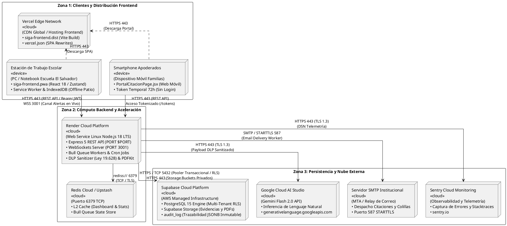

# ESPECIFICACIÓN FORMAL DEL DIAGRAMA DE INFRAESTRUCTURA Y DESPLIEGUE UML 2.5
## Vista Física y Topología de Producción — Sistema SIGA Escolar (Sprints 1 al 11)
**Cliente Institucional:** Escuela Coeducacional N° 1 El Salvador, Atacama, Chile  
**Entidad Académica:** Universidad Tecnológica de Chile INACAP (Proyecto de Título)  
**Referencia Técnica:** *UML Distilled (Martin Fowler)*, Modelo 4+1 Vistas de Kruchten (Vista Física / Despliegue), IEEE 1471 / ISO/IEC 42010  
**Versión:** 3.0 (Diseño Monocapa por Servicio / Cero Anidaciones Duplicadas / Flujo Directo Render + Vercel + Supabase)  
**Fecha:** Octubre 2026  

---

## 1. RESUMEN EJECUTIVO Y ENFOQUE ARQUITECTÓNICO

El **Diagrama de Infraestructura y Despliegue UML 2.5** documenta la arquitectura de ejecución física y lógica de **SIGA Escolar**, especificando la distribución de los componentes de software sobre la infraestructura de servidores, plataformas de nube pública (PaaS/SaaS/BaaS) y los canales de comunicación cifrados que los conectan.

### Vista Física (Kruchten 4+1)
Para garantizar alta disponibilidad, desacoplamiento y un modelado visual sin ambigüedades en Draw.io, la infraestructura se organiza en **3 zonas funcionales estrictas**, utilizando **un único nodo por servicio (diseño monocapa sin anidaciones dobles)**:

```
┌────────────────────────────────────────────────────────────────────────┐
│ ZONA 1: ACCESO Y DISTRIBUCIÓN FRONTEND                                 │
│  [Vercel Edge Network] ◄── [Estación Escuela PC]  [Smartphone Familias]│
└─────────────────────────────────────┬───────────────────┬──────────────┘
                                      │ (HTTPS / WSS)     │ (Token 72h)
┌─────────────────────────────────────▼───────────────────▼──────────────┐
│ ZONA 2: CÓMPUTO BACKEND Y ACELERACIÓN                                  │
│  [Render Cloud Platform (Node.js 18)] ────► [Redis Cloud (Caché & Bull)│
└──────────────────┬─────────────────────────────────────────────────────┘
                   │
┌──────────────────▼─────────────────────────────────────────────────────┐
│ ZONA 3: PERSISTENCIA Y SERVICIOS EXTERNOS EN LA NUBE                   │
│  [Supabase Platform]   [Google AI Studio]   [Servidor SMTP]   [Sentry] │
│  (PostgreSQL + Storage)  (Gemini Flash)      (Email Worker)   (Errors) │
└────────────────────────────────────────────────────────────────────────┘
```

1. **Zona 1 — Acceso y Distribución Frontend:**
   - **Estaciones Institucionales (Escuela El Salvador):** Navegadores web de computadores de escritorio y notebooks (Dirección, Inspectoría, Convivencia Escolar) ejecutando la SPA React 18 / Zustand con soporte PWA offline (IndexedDB / Service Worker) para contingencias en patio.
   - **Dispositivos Móviles de Apoderados:** Smartphones personales de familias accediendo al *Portal Web de Citaciones* con enlace tokenizado de 72 horas sin necesidad de login.
   - **Vercel Edge Network:** Red CDN perimetral global que aloja y distribuye los activos estáticos compilados de la aplicación con compresión y terminación SSL automática.
2. **Zona 2 — Cómputo Backend y Aceleración:**
   - **Render Cloud Platform:** Contenedor Linux administrado ejecutando el runtime Node.js 18 LTS. Centraliza el servidor Express 5 (REST API), el servidor de WebSockets Socket.io (tiempo real), los workers de colas asíncronas Bull, cron jobs, el *DLP Sanitizer* (Ley N° 19.628) y el compilador documental PDFKit.
   - **Redis Cloud / Upstash:** Motor en memoria en puerto `6379` que actúa como caché L2 de baja latencia (<50ms) y broker de persistencia de trabajos asíncronos.
3. **Zona 3 — Persistencia Gestionada y Nube Externa:**
   - **Supabase Cloud Platform:** Base de datos relacional **PostgreSQL 15** con **Row Level Security (RLS)** estricto por `tenant_id`, tabla de auditoría inmutable en JSONB (`audit_log`) y **Supabase Storage** para resguardo seguro de actas y evidencias.
   - **Google Cloud AI Studio:** API de Google Gemini Flash 2.0 consumida exclusivamente con textos previamente despojados de datos personales sensibles.
   - **Servidor SMTP Transaccional:** Relay de correo institucional autenticado con STARTTLS para el despacho de citaciones y colillas digitales.
   - **Sentry Cloud Monitoring:** Plataforma de observabilidad y telemetría de excepciones en tiempo real.

---

## 2. DIAGRAMA DE INFRAESTRUCTURA Y DESPLIEGUE (PLANTUML v3.0)

> **Nota técnica para Draw.io:** Este código utiliza nodos directos de un solo nivel (sin `node` anidado dentro de otro `node`), eliminando el efecto de cajas superpuestas o clones al mover elementos en el lienzo. Las dependencias descienden de manera vertical limpia sin cables exteriores por los márgenes.



---

## 3. DICCIONARIO TÉCNICO DE NODOS E INFRAESTRUCTURA

A continuación se detalla la matriz técnica con la totalidad de los nodos que conforman el entorno de producción de **SIGA Escolar**:

| Nodo de Infraestructura | Proveedor / Plataforma | Sistema Base / Runtime | Componentes y Artefactos Desplegados | Puertos y Protocolos | Reglas de Seguridad y Configuración |
| :--- | :--- | :--- | :--- | :--- | :--- |
| **Estación de Trabajo Escolar** | Hardware Institucional (PC / Notebook) | Windows / Linux / macOS — Navegador Chromium/Firefox | `siga-frontend.pwa`<br>`Service Worker & IndexedDB` | `In: N/A`<br>`Out: 443 (HTTPS), 3001 (WSS)` | Sesión autenticada mediante tokens Bearer JWT con rotación periódica. Persistencia local cifrada en IndexedDB para reportar incidentes en zonas sin cobertura de patio. |
| **Dispositivo Móvil Apoderados** | Hardware del Apoderado (Smartphone) | Android / iOS — Navegador Web Móvil | `PortalCitacionPage.jsx` | `In: N/A`<br>`Out: 443 (HTTPS)` | Acceso seguro 1-clic sin login mediante token criptográfico de un solo uso con caducidad estricta de 72 horas. Sin almacenamiento persistente de datos del menor en el teléfono. |
| **Vercel Edge Network** | **Vercel Cloud** (CDN Global) | Vercel Edge Serverless Engine | `siga-frontend.dist`<br>`vercel.json` | `In: 443 (HTTPS / TLS 1.3)`<br>`Out: N/A` | Distribución perimetral optimizada de la SPA compilada con Vite. Reescritura declarativa de rutas hacia `/index.html`. Encabezados de seguridad HTTP estrictos (HSTS, CSP). |
| **Render Cloud Platform** | **Render Cloud** (PaaS Web Service) | Contenedor Linux administrado (Node.js 18 LTS) | `siga-backend-api`<br>`siga-backend-ws`<br>`Bull Queue Workers`<br>`DLP Sanitizer`<br>`PDFKit Compiler` | `In: $PORT (HTTP), 3001 (WSS)`<br>`Out: 6379, 5432, 443, 587` | Perímetro protegido con Helmet, CORS estricto y rate limiting. Inyección segura de secretos (`JWT_SECRET`, `SUPABASE_SERVICE_KEY`, `GEMINI_API_KEY`). Captura `SIGTERM` para apagado elegante (*graceful shutdown*). |
| **Redis Cloud** | **Redis Cloud / Upstash** (PaaS en Memoria) | Motor Redis Standalone / Cluster | `L2 Cache Store`<br>`Queue State Store` | `In: 6379 (TCP / rediss)`<br>`Out: N/A` | Comunicación protegida con TLS (`rediss://`) y autenticación de contraseña. Caché volátil con TTL configurado por entidad y persistencia transaccional de colas asíncronas Bull. |
| **Supabase Cloud Platform** | **Supabase Platform** (BaaS / AWS) | Motor PostgreSQL 15 & Object Storage S3 | `Tablas Relacionales`<br>`audit_log (JSONB)`<br>`Buckets de Storage` | `In: 5432 (Pooler), 443 (HTTPS)`<br>`Out: N/A` | Aislamiento inviolable por establecimiento escolar mediante políticas de **Row Level Security (RLS)** asociadas a `tenant_id`. Subida y descarga de evidencias restringida mediante URLs prefirmadas temporales. |
| **Google Cloud AI Studio** | **Google Cloud Platform** (SaaS IA) | Gemini Generative Language Platform | `Gemini Flash 2.0 Engine` | `In: 443 (HTTPS / TLS 1.3)`<br>`Out: N/A` | Invocación mediante SDK `@google/genai` restringida exclusivamente a textos previamente anonimizados por el *DLP Sanitizer* en cumplimiento de la **Ley N° 19.628**. *Circuit Breaker* local de degradación grácil. |
| **Servidor SMTP Institucional** | Relay Institucional (Gmail / Google Workspace) | Protocolo SMTP Estándar | `Email Delivery Agent` | `In: 587 (SMTP STARTTLS)`<br>`Out: MX de Apoderados` | Despacho asíncrono desacoplado mediante worker en segundo plano para no demorar la respuesta al usuario. Autenticación robusta con contraseñas de aplicación seguras. |
| **Sentry Cloud Monitoring** | **Sentry.io** (SaaS de Observabilidad) | Sentry Ingestion Platform | `Error Tracker` | `In: 443 (HTTPS / TLS 1.3)`<br>`Out: N/A` | Inicialización preferente antes que Express (`initSentry()`). Captura trazas completas de error despojadas de PII para monitoreo preventivo de fallos en producción. |

---

## 4. MATRIZ DE CONECTIVIDAD, PUERTOS Y PROTOCOLOS DE RED

| Origen del Flujo | Destino del Flujo | Protocolo de Red | Puerto | Tipo de Cifrado | Propósito Técnico |
| :--- | :--- | :--- | :---: | :--- | :--- |
| Dispositivos Clientes | Vercel Edge Network | HTTPS | 443 | TLS 1.3 | Descarga de activos estáticos del frontend (HTML, JS Chunks, CSS, manifiesto PWA). |
| Estación Escuela PC | Render Cloud | HTTPS (REST) | 443 / $PORT | TLS 1.3 | Consumo de la API REST de gestión escolar autenticado con cabecera `Authorization: Bearer <JWT>`. |
| Estación Escuela PC | Render Cloud | WSS (WebSockets) | 3001 | TLS 1.3 | Canal bidireccional permanente para recepción instantánea de alertas e incidentes graves. |
| Smartphone Apoderados | Render Cloud | HTTPS (REST) | 443 / $PORT | TLS 1.3 | Acceso público tokenizado para confirmar asistencia o solicitar reprogramación de citaciones (`/tokens`). |
| Render Cloud | Redis Cloud | TCP / Rediss | 6379 | TLS | Consulta y almacenamiento en caché L2 y persistencia de trabajos asíncronos en colas Bull. |
| Render Cloud | Supabase PostgreSQL | TCP / Pooler | 5432 / 443 | TLS 1.3 | Ejecución de consultas SQL parametrizadas filtradas por `tenant_id` mediante políticas RLS. |
| Render Cloud | Supabase Storage | HTTPS | 443 | TLS 1.3 | Almacenamiento y recuperación de actas oficiales PDF compiladas y fotografías de evidencias. |
| Render Cloud | Google AI Studio | HTTPS | 443 | TLS 1.3 | Invocación de Google Gemini Flash 2.0 con payload previamente sanitizado de PII (Ley 19.628). |
| Render Cloud | Servidor SMTP | SMTP | 587 | STARTTLS | Despacho seguro de correos electrónicos con citaciones formativas y colillas digitales a familias. |
| Render Cloud | Sentry Cloud | HTTPS | 443 | TLS 1.3 | Envío de telemetría, stacktraces de errores y métricas de rendimiento en producción. |

---

## 5. GUÍA PASO A PASO PARA EL MODELADOR EN DRAW.IO

Sigue estos sencillos pasos para asegurar una importación limpia, sin elementos duplicados ni líneas cruzadas:

1. **Preparación del Lienzo (Evitar Duplicados):**
   - En Draw.io, crea un archivo nuevo o abre una pestaña en blanco.
   - Si ya tenías elementos previos en el lienzo, presiona **`Ctrl + A`** (seleccionar todo) y luego **`Supr` / `Delete`** para asegurar que el lienzo esté completamente vacío antes de insertar.
2. **Importar el Código PlantUML v3.0:**
   - Haz clic en el menú superior: **`+` (Insertar) $\rightarrow$ `Avanzado` $\rightarrow$ `PlantUML...`**.
   - Borra cualquier texto de ejemplo y pega íntegramente el bloque de código de la **Sección 2** de este documento.
   - Presiona el botón **Insertar**.
3. **Comprobación Visual Inmediata:**
   - Cada servicio aparecerá como una **caja única y limpia**: puedes hacer clic sobre cualquier nodo (como Render o Redis) y arrastrarlo sin que quede ninguna caja "fantasma" o clonada debajo.
   - Las líneas descienden de manera vertical directa desde los clientes hacia Render y desde Render hacia Supabase y los servicios externos, **sin cables largos dando la vuelta por los márgenes exteriores**.
4. **Acabado Estético Final:**
   - Selecciona los conectores, dirígete a la pestaña lateral **Estilo** y activa la opción **`Line Jumps: Arc` (Saltos de Línea en Arco)** si deseas que las intersecciones ortogonales se dibujen con curvas suaves.
5. **Exportación:**
   - Guarda el archivo nativo editable como `diagrama de infraestructura SIGA ESCOLAR.drawio`.
   - Exporta la imagen final en formato PNG de alta resolución (`Archivo -> Exportar como -> PNG...`, escala 100% o 150%, fondo blanco).
