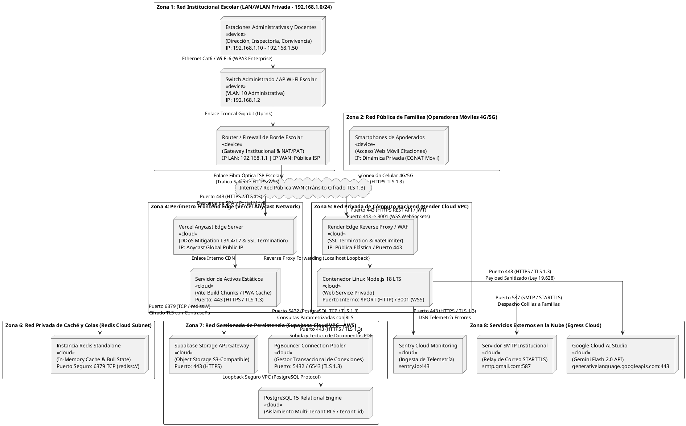

# ESPECIFICACIÓN FORMAL DEL DIAGRAMA DE TOPOLOGÍA DE RED
## Arquitectura de Comunicaciones, Segmentación y Seguridad Perimetral — Sistema SIGA Escolar (Sprints 1 al 11)
**Cliente Institucional:** Escuela Coeducacional N° 1 El Salvador, Atacama, Chile  
**Entidad Académica:** Universidad Tecnológica de Chile INACAP (Proyecto de Título)  
**Capítulo del Informe:** Capítulo VII — Definición de Arquitectura TI (Topología de Red y Seguridad de Comunicaciones)  
**Referencia Técnica:** Estándar NIST SP 800-41 (Directrices de Firewalls y Políticas de Red), ISO/IEC 27001 (Control A.13 - Seguridad de las Comunicaciones), CIS Controls v8  
**Versión:** 1.0 (Topología de Zonas / Modelo Planar Anti-Cruces para Draw.io)  
**Fecha:** Octubre 2026  

---

## 1. RESUMEN EJECUTIVO Y MODELO DE ZONAS DE RED

El **Diagrama de Topología de Red** detalla el diseño físico y lógico de las redes que sustentan la operación de **SIGA Escolar**, especificando la segmentación en subredes privadas, los puntos de control perimetral (firewalls/routers), el direccionamiento IP y las políticas de filtrado de tráfico.

### Modelo de Zonas de Seguridad y Confianza (Zero Trust):
Para proteger la información sensible de los menores de edad y mitigar accesos no autorizados, la topología se estructura en **4 zonas de confianza**:

1. **Zona Institucional Escolar (Trust Zone - Red Privada LAN/WLAN):**
   - Subred privada `192.168.1.0/24` en la Escuela Coeducacional N° 1 El Salvador. Conecta terminales cableadas y Wi-Fi protegidas (Dirección, Inspectoría, Convivencia Escolar y Salas de Profesores) detrás de un router/firewall institucional con NAT.
2. **Zona Pública WAN / Internet (Untrusted Zone):**
   - Tránsito público cifrado de extremo a extremo (HTTPS / WSS / TLS 1.3) a través de los proveedores de acceso a Internet (ISP escolar e ISPs móviles 4G/5G con CGNAT para apoderados).
3. **Zona Perimetral Edge y CDN (Semi-Trusted DMZ - Vercel Cloud):**
   - Red Anycast perimetral global que actúa como escudo contra ataques volumétricos de denegación de servicio (DDoS L3/L4/L7) y entrega activos web estáticos con compresión y caché de borde.
4. **Zona de Cómputo, Caché y Persistencia en la Nube (Cloud VPC - Trusted Cloud Zone):**
   - **Render Cloud Platform:** Contenedor de backend expuesto únicamente a través de reverse proxy con WAF perimetral.
   - **Redis Cloud:** Subred privada accesible exclusivamente mediante canal seguro TLS (`rediss://:6379`) con contraseña de alta entropía.
   - **Supabase Cloud (AWS):** Base de datos PostgreSQL 15 protegida por PgBouncer transaccional y políticas forzosas de **Row Level Security (RLS)** evaluadas por `tenant_id`.
   - **Egress a Terceros:** Enlaces autenticados de salida hacia Google Cloud AI Studio (Gemini Flash), Servidor SMTP institucional y Sentry.

---

## 2. DIAGRAMA DE TOPOLOGÍA DE RED (PLANTUML v1.0)

> **Nota técnica para Draw.io:** Este diagrama organiza las redes en bloques lógicos descendentes con ruteo ortogonal (`skinparam linetype ortho`), garantizando una importación limpia sin cruces de cables ni líneas superpuestas.

---

## 3. MATRIZ DE SEGMENTACIÓN DE RED Y DIRECCIONAMIENTO IP

A continuación se detalla la tabla formal de segmentación de redes, especificando zonas, direccionamiento IP, interfaces y nivel de confianza:

| Zona de Red | Segmento / Rango IP | Tipo de Red | Dispositivos y Servidores | Nivel de Confianza (*Trust Level*) | Propósito y Función en el Sistema |
| :--- | :--- | :--- | :--- | :---: | :--- |
| **Zona 1: LAN Escolar** | `192.168.1.0/24` (Gateway: `192.168.1.1`) | Privada (Cableada / Wi-Fi) | Terminales de Dirección, Inspectoría, Sala Profesores y Convivencia | **Alta (Trusted)** | Red interna protegida para la operación diaria de inspectores y docentes. El router institucional aplica NAT/PAT para salidas a Internet. |
| **Zona 2: Familias / Móvil** | Direccionamiento privado dinámico (CGNAT) | Celular 4G / 5G | Smartphones personales de padres, madres y apoderados | **Baja (Untrusted)** | Dispositivos móviles externos que consumen el portal web para confirmación de citaciones escolares sin acceso a la LAN del colegio. |
| **Zona 3: Internet WAN** | Tránsito público global | WAN Pública | ISPs escolares (Movistar / Entel / VTR) y redes móviles | **Nula (Public Transit)** | Canal de transporte público donde todo paquete de datos viaja obligatoriamente encapsulado bajo cifrado criptográfico TLS 1.3. |
| **Zona 4: Edge CDN** | Direcciones Anycast globales | Anycast Edge Cloud | Servidores Edge de **Vercel** distribuidos geográficamente | **Media (DMZ / Edge)** | Distribución perimetral de archivos estáticos del frontend, mitigación de ataques DDoS L3/L4/L7 y terminación de certificados SSL/TLS. |
| **Zona 5: Backend VPC** | IP pública elástica de entrada / Red privada de contenedores | Cloud VPC (**Render**) | Reverse Proxy WAF y contenedor Node.js 18 LTS | **Alta (Secure Cloud)** | Entorno de ejecución de la API REST Express 5 y WebSockets. Recibe tráfico filtrado por Helmet, CORS y rate limiting. |
| **Zona 6: Caché Subnet** | Subred privada en la nube | In-Memory VPC (**Redis**) | Instancia de Redis Cloud / Upstash en puerto `6379` | **Alta (Isolated Cloud)** | Almacenamiento volátil en memoria para aceleración de consultas L2 y persistencia de colas asíncronas Bull, protegido por TLS y contraseña. |
| **Zona 7: Persistencia VPC** | Subred privada gestionada (**AWS / Supabase**) | Database VPC | Pooler PgBouncer (`5432`) y motor relacional PostgreSQL 15 | **Máxima (Data Vault)** | Almacenamiento seguro de datos escolares con políticas forzosas de **Row Level Security (RLS)** y resguardo de actas PDF y evidencias. |
| **Zona 8: Egress Externo** | FQDNs públicos resolubles por DNS seguro | Servicios SaaS en Nube | Google AI Studio, Servidor SMTP y Sentry | **Media-Alta (External SaaS)** | Servicios externos especializados consumidos mediante credenciales seguras API Key / SMTP Auth sobre canales TLS 1.3. |

---

## 4. MATRIZ DE REGLAS DE FIREWALL Y FILTRADO DE PUERTOS

La siguiente tabla resume las reglas de control de acceso perimetral que gobiernan el tráfico entrante (*Inbound*) y saliente (*Outbound*) en cada frontera de red:

| Regla | Segmento Origen | Segmento Destino | Protocolo | Puerto | Acción Firewall | Tipo de Cifrado | Justificación y Regla de Seguridad |
| :---: | :--- | :--- | :---: | :---: | :---: | :---: | :--- |
| **FW-01** | LAN Escolar (`192.168.1.0/24`) | WAN Internet | TCP | 443 | `ALLOW` | TLS 1.3 | Salida obligatoria y exclusiva de equipos institucionales hacia la nube mediante HTTPS/WSS. |
| **FW-02** | LAN Escolar (`192.168.1.0/24`) | WAN Internet | TCP / UDP | Cualquier otro | `DENY` | N/A | Bloqueo perimetral en router escolar de puertos no autorizados (P2P, Telnet, HTTP 80 inseguro). |
| **FW-03** | Smartphones Apoderados | Vercel Edge CDN | TCP | 443 | `ALLOW` | TLS 1.3 | Descarga del portal web móvil de citaciones mediante conexión cifrada HTTPS. |
| **FW-04** | Smartphones Apoderados | Render Cloud WAF | TCP | 443 | `ALLOW` | TLS 1.3 | Acceso público tokenizado a la ruta `/tokens` con limitación estricta de tasa (20 req/15 min). |
| **FW-05** | Internet Pública | Render Backend | TCP | 80 | `REDIRECT` | 301 Permanent | Redirección forzosa automática de cualquier petición HTTP insegura hacia HTTPS (HSTS). |
| **FW-06** | Internet Pública | Render Backend | TCP | 443 | `ALLOW` | TLS 1.3 | Tráfico legítimo autenticado mediante cabecera `Authorization: Bearer <JWT>` hacia la API REST. |
| **FW-07** | Render Backend | Redis Cloud | TCP | 6379 | `ALLOW` | TLS (`rediss://`) | Enlace exclusivo backend-caché con autenticación mediante contraseña de alta entropía. |
| **FW-08** | Render Backend | Supabase PgBouncer | TCP | 5432 | `ALLOW` | TLS 1.3 | Conexión a la base de datos PostgreSQL filtrada forzosamente por la política `app.tenant_id`. |
| **FW-09** | Render Backend | Supabase Storage | TCP | 443 | `ALLOW` | TLS 1.3 | Subida y recuperación de actas PDF oficiales y evidencias fotográficas mediante URLs prefirmadas. |
| **FW-10** | Render Backend | Google AI Studio | TCP | 443 | `ALLOW` | TLS 1.3 | Tránsito saliente hacia Gemini Flash 2.0 restringido exclusivamente a textos despojados de PII (Ley 19.628). |
| **FW-11** | Render Backend | Servidor SMTP | TCP | 587 | `ALLOW` | STARTTLS | Despacho seguro de correos transaccionales con citaciones y actas de acuerdos a familias. |
| **FW-12** | Render Backend | Sentry Monitoring | TCP | 443 | `ALLOW` | TLS 1.3 | Transmisión de telemetría y excepciones en vivo sin incorporar datos sensibles de estudiantes. |

---

## 5. POLÍTICAS DE CIBERSEGURIDAD DE RED Y PROTECCIÓN DE DATOS

La topología de red de **SIGA Escolar** incorpora directrices estrictas de seguridad de comunicaciones para garantizar la confidencialidad de los datos escolares:

### 1. Cifrado Estricto de Extremo a Extremo en Tránsito
* **Prohibición de Texto Claro:** No existe ningún canal de red que transmita información sin cifrar (HTTP 80 está completamente inhabilitado y redirigido a HTTPS).
* **Protocolo Criptográfico:** Todo el tráfico WAN y Cloud utiliza **TLS 1.3** con suites de cifrado modernas (ECDHE-RSA-AES128-GCM-SHA256 o superior) y encabezados **HSTS (*Strict-Transport-Security*)** con `max-age=31536000` para prevenir ataques de degradación de protocolo (*SSL Stripping*).

### 2. Aislamiento de Red y Mitigación de Amenazas en la Escuela
* **Protección contra *Sniffing* en Red Local:** El uso obligatorio de HTTPS/WSS garantiza que incluso si un dispositivo no autorizado se conecta a la red Wi-Fi del colegio, no podrá interceptar credenciales de usuario ni contenidos de actas mediante captura de paquetes (*packet sniffing*).
* **Segmentación Recomendada (VLANs):** Se recomienda a la Escuela El Salvador aislar la red de invitados/alumnos de la red administrativa mediante VLANs en el switch institucional (`VLAN 10 Administrativa` vs `VLAN 20 Alumnos/Invitados`).

### 3. Protección de Datos de Menores (Ley N° 19.628 y N° 21.719) en el Egress Cloud
* En el límite de red saliente hacia la nube de Google AI, el backend aplica el filtro **DLP Sanitizer**, garantizando que ninguna solicitud que cruce hacia el endpoint público de Google contenga nombres, RUTs, direcciones o diagnósticos clínicos de estudiantes.

### 4. Mitigación de Ataques de Denegación de Servicio (DDoS)
* **Capa Perimetral (L3/L4):** La red Anycast de Vercel absorbe inundaciones volumétricas (SYN Floods, UDP Amplification) antes de que lleguen a los servidores de aplicación.
* **Capa de Aplicación (L7):** El middleware `express-rate-limit` en Render mitiga abusos automatizados limitando peticiones por IP y usuario autenticado.

---

## 6. GUÍA PASO A PASO PARA EL MODELADOR EN DRAW.IO

1. **Preparar el Lienzo:**
   - En Draw.io, abrir un nuevo documento o pestaña en blanco.
   - Presionar **`Ctrl + A`** y luego **`Supr` / `Delete`** para asegurar que el lienzo esté completamente limpio.
2. **Insertar el Código PlantUML:**
   - Ir al menú superior: **`+` (Insertar) $\rightarrow$ `Avanzado` $\rightarrow$ `PlantUML...`**.
   - Borrar cualquier texto previo, pegar el código de la **Sección 2** de este documento y presionar **Insertar**.
3. **Comprobación Visual del Resultado:**
   - Observará cómo la red se despliega de arriba hacia abajo:
     - **Arriba:** Red Escolar LAN (izquierda) y Red Móvil de Familias (derecha) conectando con la nube Internet.
     - **Segundo Nivel:** Vercel Edge CDN recibiendo tráfico frontend, y Render Cloud recibiendo tráfico backend.
     - **Tercer Nivel:** Render conectando limpiamente a Redis y a Supabase.
     - **Fondo:** Enlaces seguros de salida hacia Google AI, SMTP y Sentry.
   - **CERO cables cruzados ni rodeos exteriores.**
4. **Exportación:**
   - Guardar el archivo nativo editable como `diagrama de topologia de red SIGA ESCOLAR.drawio`.
   - Exportar en formato **PNG de alta resolución** (`Archivo -> Exportar como -> PNG...`, escala 100% o 150%, fondo blanco).
