# ESPECIFICACIÓN FORMAL DEL MODELO DE DATOS RELACIONAL Y CLASES DE ENTIDAD
## Arquitectura de Persistencia, Modelo E-R Extendido y Seguridad de Datos — Sistema SIGA Escolar (Sprints 1 al 11)
**Cliente Institucional:** Escuela Coeducacional N° 1 El Salvador, Atacama, Chile  
**Entidad Académica:** Universidad Tecnológica de Chile INACAP (Proyecto de Título)  
**Capítulo del Informe:** Capítulo VII — Definición de Arquitectura TI (Modelo de Datos Relacional y Esquema Físico)  
**Referencia Técnica:** Estándar ANSI/ISO SQL:2016, UML 2.5 (Diagrama de Clases de Entidad / Perfil de Datos), ISO/IEC 25010 (Calidad del Software: Integridad y Seguridad), Ley N° 19.628 (Protección de la Vida Privada y Datos Personales de Menores) y Ley N° 21.719  
**Versión:** 1.0 (Arquitectura Relacional Normalizada 3FN + Extensiones NoSQL/Vectoriales + Multi-Tenancy RLS)  
**Fecha:** Octubre 2026  

---

## 1. RESUMEN EJECUTIVO Y FUNDAMENTOS DEL MODELO DE DATOS

El **Modelo de Datos Relacional** de **SIGA Escolar** define la estructura formal de almacenamiento persistente, la integridad referencial y las políticas de acceso a los datos de la plataforma. La base de datos opera sobre el motor relacional **PostgreSQL 15** (desplegado en **Supabase Cloud Managed Infrastructure sobre AWS**), complementado con extensiones analíticas avanzadas como **`pgvector`** para inteligencia artificial y tipos nativos **`JSONB`** para estructuración documental flexible.

### Principios Fundamentales del Diseño de Datos:

1. **Aislamiento Estricto Multi-Tenancy con Row Level Security (RLS):**
   - El sistema opera en modalidad Multi-Tenant compartiendo un único esquema de base de datos (`public`), donde cada registro en las tablas operativas incorpora la columna foránea obligatoria `tenant_id : UUID`.
   - La seguridad de acceso está garantizada en el núcleo del motor mediante políticas forzosas de **Row Level Security (RLS)** a nivel de base de datos (`current_setting('app.tenant_id')`), impidiendo que cualquier consulta o inyección SQL pueda filtrar o cruzar información entre distintos colegios.

2. **Normalización y Balance Híbrido (3FN + JSONB):**
   - Los dominios transaccionales de alumnos, incidentes, protocolos y mediación están estructurados en **Tercera Forma Normal (3FN)** para evitar redundancias, anomalías de inserción y problemas de inconsistencia.
   - Se utiliza **`JSONB`** en campos con semántica semiestructurada o matricial compleja, como las matrices de respuestas de sociogramas (`respuestas_matriz`), los criterios de disparo automático de protocolos RICE (`criterio_disparo`) y las instantáneas de bitácora (`datos_before` / `datos_after`).

3. **Inteligencia Artificial y Búsqueda Semántica Vectorial (`pgvector`):**
   - Incorporación de la tabla `rice_chunks` con columnas tipo **`vector(768)`**, dimensionadas exactamente para almacenar los *embeddings* generados por la API de **Google Gemini Flash**. Esto permite implementar un sistema RAG (*Retrieval-Augmented Generation*) para contrastar incidentes escolares en tiempo real con el Reglamento Interno de Convivencia Escolar (RICE).

4. **Privacidad de Datos de Menores por Diseño (*Privacy by Design* — Ley N° 19.628):**
   - Segmentación de datos especialmente sensibles (como `perfiles_medicos` con diagnósticos clínicos y alergias, relatos de testimonios en `entrevistas` y registros de `sociogramas_curso`) protegidos por permisos RBAC restringidos exclusivamente a Directivos y Equipo de Formación/Convivencia Escolar.

5. **Inmutabilidad y Trazabilidad Absoluta:**
   - Registro cronológico forense en la tabla `auditoria`, con bloqueo a nivel de triggers ante intentos de modificación (`UPDATE`) o borrado (`DELETE`), garantizando respaldo legal ante fiscalizaciones de la Superintendencia de Educación.

---

## 2. DIAGRAMA DE MODELO DE DATOS UNIFICADO (PLANTUML v1.0)

> **Nota técnica de visualización:** Este diagrama unificado consolida las 28 tablas del sistema en 2 columnas paralelas simétricas con ruteo ortogonal (`skinparam linetype ortho`), eliminando cruces diagonales desordenados (*spaghetti*) y optimizado con resolución de **300 DPI** y tipografía ampliada (**14pt**) para lectura nítida en el informe.

```plantuml
@startuml
skinparam dpi 300
skinparam roundcorner 6
skinparam linetype ortho
skinparam nodesep 26
skinparam ranksep 30
skinparam packageStyle rectangle
skinparam shadowing false
skinparam classFontSize 14
skinparam classFontName "Helvetica"
skinparam defaultFontSize 13
skinparam defaultTextAlignment left
skinparam arrowColor #1e3a5f
skinparam noteFontSize 12
skinparam classBackgroundColor #FFFFFF
skinparam classBorderColor #475569

title **SIGA Escolar — Modelo de Datos Relacional Unificado (Alta Resolución)**\n(Core MVP + RICE + Cierre de Año + Sprints 6, 7, 8 y 10)

' ==============================================================================
' COLUMNA 1: GESTIÓN ESCOLAR, ROLES Y ESTUDIANTES
' ==============================================================================

package "1. Núcleo, Seguridad y Auditoría" as P1 #F8FAFC {
  entity "tenants" as tenants <<Colegio>> {
    * **id** : UUID <<PK>>
    --
    * nombre : VARCHAR(200)
    * rbd : VARCHAR(20) <<UNIQUE>>
    * direccion : VARCHAR(255)
    telefono : VARCHAR(50)
    email_contacto : VARCHAR(100)
    configuracion_notificaciones : JSONB
    activo : BOOLEAN = true
    * created_at : TIMESTAMPTZ
  }

  entity "usuarios" as usuarios <<Cuentas y RBAC>> {
    * **id** : UUID <<PK>>
    --
    * **tenant_id** : UUID <<FK>>
    * email : VARCHAR(150) <<UNIQUE>>
    * password_hash : VARCHAR(255)
    * nombre : VARCHAR(100)
    * apellido : VARCHAR(100)
    * rol : ENUM
    activo : BOOLEAN = true
    bloqueado_hasta : TIMESTAMPTZ
  }

  entity "auditoria" as auditoria <<Bitácora>> {
    * **id** : UUID <<PK>>
    --
    * **tenant_id** : UUID <<FK>>
    **usuario_id** : UUID <<FK>>
    * accion : VARCHAR(20)
    * tabla : VARCHAR(50)
    registro_id : UUID
    datos_before : JSONB
    datos_after : JSONB
    ip_origen : VARCHAR(45)
    * created_at : TIMESTAMPTZ
  }

  entity "notificaciones" as notificaciones <<Alertas>> {
    * **id** : UUID <<PK>>
    --
    * **tenant_id** : UUID <<FK>>
    * **usuario_id** : UUID <<FK>>
    tipo : VARCHAR(50)
    titulo : VARCHAR(150)
    mensaje : TEXT
    leida : BOOLEAN = false
    * created_at : TIMESTAMPTZ
  }

  tenants ||--o{ usuarios : "pertenece a"
  tenants ||--o{ auditoria : "registra"
  usuarios ||--o{ notificaciones : "recibe"
}

package "2. Estructura Académica y Matrículas" as P2 #EFF6FF {
  entity "periodos_academicos" as periodos <<Años Lectivos>> {
    * **id** : UUID <<PK>>
    --
    * **tenant_id** : UUID <<FK>>
    * anio : INT
    fecha_inicio : DATE
    fecha_termino : DATE
    activo : BOOLEAN = true
  }

  entity "cursos" as cursos <<Cursos>> {
    * **id** : UUID <<PK>>
    --
    * **tenant_id** : UUID <<FK>>
    * **periodo_id** : UUID <<FK>>
    **profesor_jefe_id** : UUID <<FK>>
    * nombre : VARCHAR(50)
    * nivel : VARCHAR(20)
    * letra : CHAR(1)
  }

  entity "estudiantes" as estudiantes <<Alumnos>> {
    * **id** : UUID <<PK>>
    --
    * **tenant_id** : UUID <<FK>>
    **curso_id** : UUID <<FK>>
    * rut : VARCHAR(12)
    * nombre : VARCHAR(100)
    * apellido : VARCHAR(100)
    es_pie : BOOLEAN = false
    tipo_diagnostico_pie : VARCHAR(100)
    estado_matricula : ENUM
    activo : BOOLEAN = true
  }

  entity "matriculas" as matriculas <<Historial (PKG-06)>> {
    * **id** : UUID <<PK>>
    --
    * **tenant_id** : UUID <<FK>>
    * **estudiante_id** : UUID <<FK>>
    **curso_id** : UUID <<FK>>
    * **periodo_id** : UUID <<FK>>
    * anio : INT
    * estado_final : ENUM
    * fecha_matricula : DATE
  }

  entity "apoderados" as apoderados <<Familias>> {
    * **id** : UUID <<PK>>
    --
    * **tenant_id** : UUID <<FK>>
    **estudiante_id** : UUID <<FK>>
    * rut : VARCHAR(12)
    * nombre : VARCHAR(100)
    parentesco : VARCHAR(50)
    telefono : VARCHAR(50)
    es_titular : BOOLEAN = true
  }

  entity "funcionarios" as funcionarios <<Docentes>> {
    * **id** : UUID <<PK>>
    --
    * **tenant_id** : UUID <<FK>>
    **usuario_id** : UUID <<FK>>
    * rut : VARCHAR(12)
    * nombre : VARCHAR(100)
    * cargo : VARCHAR(100)
  }

  periodos ||--o{ cursos : "contiene"
  cursos ||--o{ estudiantes : "agrupa"
  estudiantes ||--o{ matriculas : "historial"
  periodos ||--o{ matriculas : "año"
  estudiantes ||--o{ apoderados : "tutor"
  usuarios ||--o| funcionarios : "perfil"
}

package "6. Salud y Sociometría" as P6 #FDF2F8 {
  entity "perfiles_medicos" as perfiles_medicos <<Ley 19.628>> {
    * **id** : UUID <<PK>>
    --
    * **tenant_id** : UUID <<FK>>
    * **estudiante_id** : UUID <<FK, UNIQUE>>
    alergias : TEXT
    condiciones_cronicas : TEXT
    medicamentos_habituales : TEXT
    requiere_atencion_especial : BOOLEAN
    contacto_emergencia_nombre : VARCHAR(100)
    contacto_emergencia_fono : VARCHAR(50)
  }

  entity "sociogramas_curso" as sociogramas <<Relaciones (PKG-08)>> {
    * **id** : UUID <<PK>>
    --
    * **tenant_id** : UUID <<FK>>
    * **curso_id** : UUID <<FK>>
    * **periodo_id** : UUID <<FK>>
    * fecha_aplicacion : DATE
    preguntas_json : JSONB
    respuestas_matriz : JSONB
    indices_cohesion : JSONB
  }

  estudiantes ||--o| perfiles_medicos : "ficha médica"
  cursos ||--o{ sociogramas : "evalúa curso"
}

' ==============================================================================
' COLUMNA 2: CONVIVENCIA ESCOLAR, PROTOCOLOS Y MEDIACIÓN
' ==============================================================================

package "3. Gestión de Incidentes" as P3 #FFFBEB {
  entity "tipos_abordaje" as tipos_abordaje <<Severidad>> {
    * **id** : UUID <<PK>>
    --
    * **tenant_id** : UUID <<FK>>
    * codigo : VARCHAR(20)
    * nombre : VARCHAR(100)
    * severidad : ENUM
    requiere_protocolo : BOOLEAN = false
  }

  entity "incidentes" as incidentes <<Expediente Principal>> {
    * **id** : UUID <<PK>>
    --
    * **tenant_id** : UUID <<FK>>
    * **tipo_abordaje_id** : UUID <<FK>>
    * folio : VARCHAR(30) <<UNIQUE>>
    * titulo : VARCHAR(200)
    * descripcion : TEXT
    * fecha_incidente : TIMESTAMPTZ
    lugar : VARCHAR(100)
    * estado : ENUM
    nivel_urgencia : ENUM
  }

  entity "incidente_estudiantes" as inc_estudiantes <<Involucrados>> {
    * **id** : UUID <<PK>>
    --
    * **incidente_id** : UUID <<FK>>
    * **estudiante_id** : UUID <<FK>>
    * rol_participacion : ENUM
    medidas_adoptadas : TEXT
  }

  entity "entrevistas" as entrevistas <<Declaraciones>> {
    * **id** : UUID <<PK>>
    --
    * **incidente_id** : UUID <<FK>>
    * fecha_entrevista : TIMESTAMPTZ
    * tipo_entrevistado : ENUM
    entrevistado_nombre : VARCHAR(150)
    * relato : TEXT
  }

  entity "reportes_convivencia" as reportes <<Estadísticas>> {
    * **id** : UUID <<PK>>
    --
    * **tenant_id** : UUID <<FK>>
    * **periodo_id** : UUID <<FK>>
    * tipo_reporte : VARCHAR(50)
    * fecha_generacion : TIMESTAMPTZ
    archivo_pdf_url : TEXT
  }

  tipos_abordaje ||--o{ incidentes : "clasifica"
  incidentes ||--o{ inc_estudiantes : "involucra"
  incidentes ||--o{ entrevistas : "testimonio"
}

package "4. Protocolos RICE" as P4 #FEF2F2 {
  entity "tipos_protocolo" as tipos_protocolo <<Marco Normativo>> {
    * **id** : UUID <<PK>>
    --
    * **tenant_id** : UUID <<FK>>
    * codigo : VARCHAR(30)
    * nombre : VARCHAR(150)
    plazo_horas_maximo : INT
    activo : BOOLEAN = true
  }

  entity "reglas_protocolo" as reglas_protocolo <<Condiciones>> {
    * **id** : UUID <<PK>>
    --
    * **tipo_protocolo_id** : UUID <<FK>>
    * criterio_disparo : JSONB
    * accion_automatica : VARCHAR(100)
    * prioridad : INT
  }

  entity "pasos_protocolo" as pasos_protocolo <<Secuencia>> {
    * **id** : UUID <<PK>>
    --
    * **incidente_id** : UUID <<FK>>
    * **tipo_protocolo_id** : UUID <<FK>>
    * orden : INT
    * nombre_paso : VARCHAR(150)
    * estado : ENUM
    fecha_limite : TIMESTAMPTZ
  }

  entity "evidencias_paso" as evidencias <<Respaldos>> {
    * **id** : UUID <<PK>>
    --
    * **paso_id** : UUID <<FK>>
    * nombre_archivo : VARCHAR(255)
    * url_archivo : TEXT
    tipo_archivo : VARCHAR(50)
  }

  tipos_protocolo ||--o{ reglas_protocolo : "reglas"
  tipos_protocolo ||--o{ pasos_protocolo : "secuencia"
  pasos_protocolo ||--o{ evidencias : "respalda"
}

package "5. Citaciones y Mediación" as P5 #F0FDF4 {
  entity "citaciones" as citaciones <<Entrevistas (PKG-07)>> {
    * **id** : UUID <<PK>>
    --
    * **tenant_id** : UUID <<FK>>
    **incidente_id** : UUID <<FK>>
    * **estudiante_id** : UUID <<FK>>
    **apoderado_id** : UUID <<FK>>
    * folio : VARCHAR(30) <<UNIQUE>>
    * fecha_hora : TIMESTAMPTZ
    * motivo : TEXT
    * estado : ENUM
  }

  entity "acuerdos_citacion" as acuerdos_citacion <<Compromisos>> {
    * **id** : UUID <<PK>>
    --
    * **citacion_id** : UUID <<FK>>
    * descripcion : TEXT
    * responsable : VARCHAR(100)
    * fecha_compromiso : DATE
    cumplido : BOOLEAN = false
  }

  entity "mediaciones" as mediaciones <<Resolución (PKG-07)>> {
    * **id** : UUID <<PK>>
    --
    * **tenant_id** : UUID <<FK>>
    **incidente_id** : UUID <<FK>>
    * folio : VARCHAR(30) <<UNIQUE>>
    * fecha_apertura : DATE
    * estado : ENUM
    * resultado_final : TEXT
  }

  entity "mediacion_participantes" as med_participantes <<Partes>> {
    * **id** : UUID <<PK>>
    --
    * **mediacion_id** : UUID <<FK>>
    * **estudiante_id** : UUID <<FK>>
    * rol : ENUM
  }

  entity "compromisos_mediacion" as compromisos_med <<Acta>> {
    * **id** : UUID <<PK>>
    --
    * **mediacion_id** : UUID <<FK>>
    * descripcion : TEXT
    * fecha_seguimiento : DATE
    estado_verificacion : ENUM
  }

  citaciones ||--o{ acuerdos_citacion : "genera acuerdos"
  mediaciones ||--o{ med_participantes : "participan"
  mediaciones ||--o{ compromisos_med : "compromisos"
}

package "7. Inteligencia RICE RAG" as P7 #F5F3FF {
  entity "rice_documentos" as rice_docs <<PDF Normativas>> {
    * **id** : UUID <<PK>>
    --
    * **tenant_id** : UUID <<FK>>
    * titulo : VARCHAR(200)
    * version : VARCHAR(20)
    * vigencia_anio : INT
    * url_archivo : TEXT
  }

  entity "rice_chunks" as rice_chunks <<Vectores pgvector>> {
    * **id** : UUID <<PK>>
    --
    * **documento_id** : UUID <<FK>>
    * capitulo_seccion : VARCHAR(150)
    * contenido : TEXT
    * embedding : vector(768)
    pagina : INT
  }

  rice_docs ||--o{ rice_chunks : "vectoriza"
}

' ==============================================================================
' ENLACES Y ALINEACIÓN DE COLUMNAS
' ==============================================================================
estudiantes -right-> inc_estudiantes : "involucrado"
incidentes -down-> pasos_protocolo : "activa"
incidentes -down-> citaciones : "origina"
incidentes -down-> mediaciones : "deriva"

P1 -[hidden]down-> P2
P2 -[hidden]down-> P6

P3 -[hidden]down-> P4
P4 -[hidden]down-> P5
P5 -[hidden]down-> P7

P1 -[hidden]right-> P3
P2 -[hidden]right-> P4

note right of P1
  **Multi-Tenancy (Row Level Security):**
  Todas las entidades poseen **tenant_id : UUID <<FK>>**
  para aislamiento estricto por colegio en Supabase.
end note

@enduml
```



---

## 3. DIAGRAMAS MODULARES POR DOMINIO (VISTAS DE PÁGINA COMPLETA)

Para asegurar la **máxima legibilidad** en el cuerpo del documento Word o PDF sin obligar al evaluador a hacer zoom, el modelo se descompone en **dos láminas arquitectónicas especializadas**, cada una dimensionada para ocupar el 100% de una página estándar:

### 3.1 Lámina A: Módulo Académico, Matrículas y Salud (12 Tablas)
- **Alcance:** Núcleo institucional, usuarios RBAC, bitácora de auditoría inmutable, notificaciones, cursos, periodos académicos, estudiantes, matrículas históricas, apoderados, docentes, fichas de salud médica (Ley 19.628) y sociogramas escolares.
- **Archivo PlantUML:** [`MODELO_DE_DATOS_MODULO_ACADEMICO.puml`](file:///home/macevedo/Proyectos/INACAP/siga-escolar/DOCS/Estructura/08_Evidencia_Tecnica_de_Avance/diagramas/modelo%20de%20datos/MODELO_DE_DATOS_MODULO_ACADEMICO.puml)

### 3.2 Lámina B: Convivencia Escolar, Protocolos RICE, Mediación e IA RAG (16 Tablas)
- **Alcance:** Expedientes de incidentes, alumnos involucrados con roles (agresor/afectado/testigo), testimonios y entrevistas formales, reportes normativos, catálogo y reglas automáticas de protocolos RICE, pasos y evidencias documentales, citaciones familiares con acuerdos, mediaciones restaurativas con actas de compromiso, y chunks vectorizados para el motor RAG (`vector(768)`).
- **Archivo PlantUML:** [`MODELO_DE_DATOS_MODULO_CONVIVENCIA.puml`](file:///home/macevedo/Proyectos/INACAP/siga-escolar/DOCS/Estructura/08_Evidencia_Tecnica_de_Avance/diagramas/modelo%20de%20datos/MODELO_DE_DATOS_MODULO_CONVIVENCIA.puml)

---

## 4. DICCIONARIO DE DATOS RELACIONAL MAESTRO (CATÁLOGO DE LAS 28 ENTIDADES)

La siguiente tabla describe exhaustivamente cada una de las 28 entidades del modelo relacional de **SIGA Escolar**, detallando su propósito funcional, llaves y clasificación de sensibilidad bajo la Ley N° 19.628:

| # | Entidad / Tabla | Paquete / Dominio | Claves Principales (PK / FK) | Propósito Técnico y Funcional en el Sistema | Nivel de Sensibilidad (Ley 19.628 / RLS) |
| :-: | :--- | :--- | :--- | :--- | :---: |
| **1** | `tenants` | 1. Núcleo | **PK:** `id` | Registro de colegios y escuelas suscritas (RBD único, datos de contacto y configuración institucional). | **Pública / Operativa** |
| **2** | `usuarios` | 1. Núcleo | **PK:** `id`<br>**FK:** `tenant_id` | Cuentas de usuario con hash seguro de contraseñas (`bcrypt`), control de intentos fallidos y rol RBAC. | **Confidencial (Credenciales)** |
| **3** | `auditoria` | 1. Núcleo | **PK:** `id`<br>**FK:** `tenant_id`, `usuario_id` | Bitácora inmutable de seguridad. Registra inserciones, modificaciones y borrados con datos antes/después en JSONB e IP de origen. | **Auditoría Forense** |
| **4** | `notificaciones` | 1. Núcleo | **PK:** `id`<br>**FK:** `tenant_id`, `usuario_id` | Alertas in-app y recordatorios automatizados de plazos perentorios de protocolos y citaciones. | **Interno Operativo** |
| **5** | `periodos_academicos` | 2. Académico | **PK:** `id`<br>**FK:** `tenant_id` | Define los años lectivos escolares oficiales, fecha de inicio, fecha de término y vigencia operativa. | **Pública Institucional** |
| **6** | `cursos` | 2. Académico | **PK:** `id`<br>**FK:** `tenant_id`, `periodo_id`, `profesor_jefe_id` | Niveles y secciones escolares (ej: 1° Básico A), con vinculación al docente designado como profesor jefe. | **Interno Académico** |
| **7** | `estudiantes` | 2. Académico | **PK:** `id`<br>**FK:** `tenant_id`, `curso_id` | Ficha maestra del alumno matriculado (RUT, nombre, datos demográficos, indicador PIE y diagnóstico asociado). | **Dato Personal Protegido** |
| **8** | `matriculas` | 2. Académico | **PK:** `id`<br>**FK:** `tenant_id`, `estudiante_id`, `curso_id`, `periodo_id` | Historial longitudinal de matrícula, repitencia y promoción por año lectivo (Soporte al Cierre de Año Escolar PKG-06). | **Dato Personal / Académico** |
| **9** | `apoderados` | 2. Académico | **PK:** `id`<br>**FK:** `tenant_id`, `estudiante_id` | Registro de tutores legales, parentesco, teléfonos y correos electrónicos para citaciones y notificaciones de emergencia. | **Dato Personal Protegido** |
| **10** | `funcionarios` | 2. Académico | **PK:** `id`<br>**FK:** `tenant_id`, `usuario_id` | Información laboral de docentes, inspectores y directivos del establecimiento vinculados a su cuenta de acceso. | **Interno Laboral** |
| **11** | `perfiles_medicos` | 6. Salud / Sociometría | **PK:** `id`<br>**FK:** `tenant_id`, `estudiante_id` (1:1) | Ficha clínica protegida de salud: alergias severas, condiciones crónicas, medicamentos y contactos de urgencia. | **Dato Sensible (Máxima Protección)** |
| **12** | `sociogramas_curso` | 6. Salud / Sociometría | **PK:** `id`<br>**FK:** `tenant_id`, `curso_id`, `periodo_id` | Matriz sociométrica de vínculos interpersonales en el aula, preguntas, índices de cohesión y detección de alumnos aislados. | **Dato Sensible Psicosocial** |
| **13** | `tipos_abordaje` | 3. Convivencia | **PK:** `id`<br>**FK:** `tenant_id` | Catálogo tipificador de conductas según el RICE institucional (Leve, Grave, Gravísima) y obligatoriedad de protocolo. | **Normativo / Catálogo** |
| **14** | `incidentes` | 3. Convivencia | **PK:** `id`<br>**FK:** `tenant_id`, `tipo_abordaje_id` | Expediente digital principal del caso de convivencia: folio único institucional, fecha, lugar, descripción fáctica y estado. | **Dato Confidencial / Legal** |
| **15** | `incidente_estudiantes` | 3. Convivencia | **PK:** `id`<br>**FK:** `incidente_id`, `estudiante_id` | Tabla asociativa N:M que define la participación específica del alumno (Afectado, Agresor o Testigo) y medidas de resguardo. | **Dato Confidencial / Legal** |
| **16** | `entrevistas` | 3. Convivencia | **PK:** `id`<br>**FK:** `incidente_id` | Declaraciones testimoniales formales tomadas a estudiantes, apoderados o docentes, con relatos y firmas de compromiso. | **Dato Sensible Testimonial** |
| **17** | `reportes_convivencia` | 3. Convivencia | **PK:** `id`<br>**FK:** `tenant_id`, `periodo_id` | Informes consolidados de gestión de convivencia generados para directivos o requerimientos de la Superintendencia. | **Reporte Institucional** |
| **18** | `tipos_protocolo` | 4. Protocolos RICE | **PK:** `id`<br>**FK:** `tenant_id` | Catálogo de protocolos normativos oficiales (ej: Maltrato Infantil, Acoso Escolar, Porte de Armas, Vulneración de Derechos). | **Normativo / RICE** |
| **19** | `reglas_protocolo` | 4. Protocolos RICE | **PK:** `id`<br>**FK:** `tipo_protocolo_id` | Reglas lógicas y disparadores automáticos en JSONB que enlazan la tipificación del incidente con la apertura del protocolo. | **Motor de Reglas** |
| **20** | `pasos_protocolo` | 4. Protocolos RICE | **PK:** `id`<br>**FK:** `incidente_id`, `tipo_protocolo_id` | Etapas secuenciales de ejecución obligatoria, plazos perentorios de cumplimiento y control de estado (Pendiente a Completado). | **Trazabilidad Legal** |
| **21** | `evidencias_paso` | 4. Protocolos RICE | **PK:** `id`<br>**FK:** `paso_id` | Registros documentales adjuntos a cada etapa (certificados médicos, capturas de pantalla, informes psicosociales en PDF). | **Evidencia Reservada** |
| **22** | `citaciones` | 5. Citaciones / Mediación | **PK:** `id`<br>**FK:** `tenant_id`, `incidente_id`, `estudiante_id`, `apoderado_id` | Convocatorias formales a entrevistas entre apoderados y el colegio con folio único, fecha/hora y motivo documentado. | **Confidencial Familiar** |
| **23** | `acuerdos_citacion` | 5. Citaciones / Mediación | **PK:** `id`<br>**FK:** `citacion_id` | Compromisos pactados durante la citación formal, designando responsable institucional/familiar y fecha de verificación. | **Acta Vinculante** |
| **24** | `mediaciones` | 5. Citaciones / Mediación | **PK:** `id`<br>**FK:** `tenant_id`, `incidente_id` | Expediente formal de resolución pacífica de controversias entre pares guiado por un facilitador de convivencia. | **Confidencial Restaurativo** |
| **25** | `mediacion_participantes` | 5. Citaciones / Mediación | **PK:** `id`<br>**FK:** `mediacion_id`, `estudiante_id` | Estudiantes que participan voluntariamente en el proceso de mediación (Solicitante, Invitado o Facilitador). | **Confidencial Restaurativo** |
| **26** | `compromisos_mediacion` | 5. Citaciones / Mediación | **PK:** `id`<br>**FK:** `mediacion_id` | Acuerdos mutuos de convivencia y reparación del daño establecidos en el acta de mediación, con seguimiento calendarizado. | **Acta Vinculante** |
| **27** | `rice_documentos` | 7. IA RAG / Vectores | **PK:** `id`<br>**FK:** `tenant_id` | Archivo digital en PDF del Reglamento Interno de Convivencia Escolar y protocolos normativos oficiales vigentes. | **Normativa Pública** |
| **28** | `rice_chunks` | 7. IA RAG / Vectores | **PK:** `id`<br>**FK:** `documento_id` | Fragmentos textuales seccionados por artículos con su representación matemática vectorial (**`vector(768)`**) para búsqueda semántica. | **Índice Vectorial IA** |

---

## 5. POLÍTICAS DE INTEGRIDAD REFERENCIAL, RESTRICCIONES Y SEGURIDAD

### 1. Comportamiento ante Eliminación de Registros (*Referential Actions*):
* **`ON DELETE RESTRICT` (Protección Legal Obligatoria):**
  - Aplicado en `tenants`, `estudiantes`, `incidentes`, `entrevistas` y `mediaciones`. Impide la eliminación física de registros que posean dependencias activas, garantizando el principio de no repudio y conservación de expedientes escolares por un mínimo de 5 años.
* **`ON DELETE CASCADE` (Limpieza de Dependencias Fuertes):**
  - Aplicado estrictamente a tablas secundarias dependientes: `pasos_protocolo` $\rightarrow$ `evidencias_paso`, `citaciones` $\rightarrow$ `acuerdos_citacion`, `mediaciones` $\rightarrow$ `compromisos_mediacion`, y `rice_documentos` $\rightarrow$ `rice_chunks`.
* **`ON DELETE SET NULL` (Desvinculación Segura):**
  - En la relación `cursos` $\rightarrow$ `profesor_jefe_id`. Si un docente cesa en su cargo, el curso no se elimina; su jefatura queda vacante temporalmente.

### 2. Restricciones de Dominio y Validación (*CHECK Constraints*):
* **RUT Chileno Formateado:** Expresión regular `CHECK (rut ~ '^[0-9]{7,8}-[0-9kK]{1}$')` en `estudiantes`, `apoderados` y `funcionarios`.
* **Severidad Normalizada:** `CHECK (severidad IN ('Leve', 'Grave', 'Gravisima'))` en `tipos_abordaje`.
* **Estado de Matrícula:** `CHECK (estado_final IN ('En Curso', 'Promovido', 'Repitente', 'Egresado', 'Retirado'))` en `matriculas`.

### 3. Inmutabilidad de la Bitácora de Auditoría:
* Se implementa un disparador a nivel de PostgreSQL que aborta cualquier intento de alteración sobre la tabla `auditoria`:
  ```sql
  CREATE OR REPLACE FUNCTION trg_prevent_audit_tampering()
  RETURNS TRIGGER AS $$
  BEGIN
    RAISE EXCEPTION 'Operación denegada: La bitácora de auditoría de SIGA Escolar es estrictamente inmutable.';
  END;
  $$ LANGUAGE plpgsql;

  CREATE TRIGGER trg_audit_no_update_delete
  BEFORE UPDATE OR DELETE ON auditoria
  FOR EACH ROW EXECUTE FUNCTION trg_prevent_audit_tampering();
  ```

### 4. Implementación del Aislamiento Row Level Security (RLS en Supabase):
* Cada tabla con la columna `tenant_id` tiene RLS habilitado de manera mandatoria:
  ```sql
  ALTER TABLE incidentes ENABLE ROW LEVEL SECURITY;

  CREATE POLICY tenant_isolation_policy ON incidentes
  FOR ALL
  USING (tenant_id = (current_setting('app.tenant_id', true))::uuid)
  WITH CHECK (tenant_id = (current_setting('app.tenant_id', true))::uuid);
  ```

---

## 6. GUÍA DE GENERACIÓN, RENDERIZADO Y EXPORTACIÓN

### 1. Renderizado en VS Code con Extensión PlantUML:
1. Asegúrese de tener configurado el renderizado por servidor en los ajustes de VS Code:
   - Presione `Ctrl + ,` $\rightarrow$ busque `plantuml render` $\rightarrow$ elija `PlantUMLServer`.
2. Abra cualquiera de los tres archivos de diagrama:
   - [`MODELO_DE_DATOS_RELACIONAL.puml`](file:///home/macevedo/Proyectos/INACAP/siga-escolar/DOCS/Estructura/08_Evidencia_Tecnica_de_Avance/diagramas/modelo%20de%20datos/MODELO_DE_DATOS_RELACIONAL.puml) (Unificado para hoja horizontal).
   - [`MODELO_DE_DATOS_MODULO_ACADEMICO.puml`](file:///home/macevedo/Proyectos/INACAP/siga-escolar/DOCS/Estructura/08_Evidencia_Tecnica_de_Avance/diagramas/modelo%20de%20datos/MODELO_DE_DATOS_MODULO_ACADEMICO.puml) (Lámina 1 vertical).
   - [`MODELO_DE_DATOS_MODULO_CONVIVENCIA.puml`](file:///home/macevedo/Proyectos/INACAP/siga-escolar/DOCS/Estructura/08_Evidencia_Tecnica_de_Avance/diagramas/modelo%20de%20datos/MODELO_DE_DATOS_MODULO_CONVIVENCIA.puml) (Lámina 2 vertical).
3. Presione el atajo de teclado **`Alt + D`** (o `Option + D` en macOS) para abrir la ventana de previsualización en vivo.

### 2. Exportación a Formato Gráfico de Alta Fidelidad:
1. Presione `Ctrl + Shift + P` en VS Code.
2. Escriba y seleccione: **`PlantUML: Export Current Diagram`**.
3. Seleccione el formato deseado:
   - **`png`**: Para insertar directamente como imagen en Word con resolución nítida a 300 DPI.
   - **`svg`**: Para inserción vectorial en documentos PDF o LaTeX sin degradación de calidad al ampliar.

### 3. Recomendación de Inserción en el Informe de Título INACAP:
* **Estrategia Recomendada:** Insertar en el cuerpo del informe las **dos láminas modulares** (Lámina A en la página $N$ y Lámina B en la página $N+1$), acompañadas de la **Tabla del Diccionario de Datos (Sección 4)**. Esto garantiza una lectura fluida, profesional y evaluable con letra en tamaño estándar de 12pt a 14pt.
* **Diagrama Unificado:** Puede colocarse en una página en disposición horizontal (*Landscape*) o incluirse en el apartado de **Anexos Técnicos** del proyecto.
